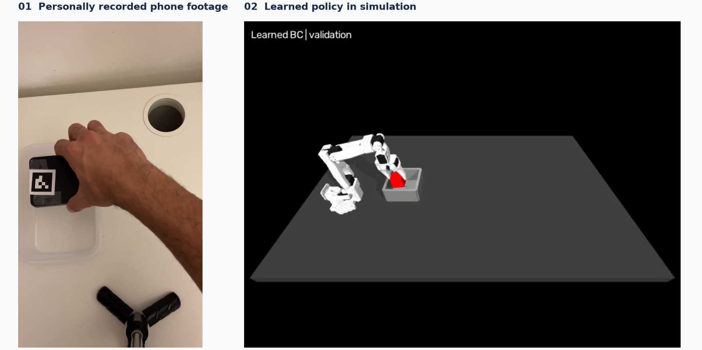
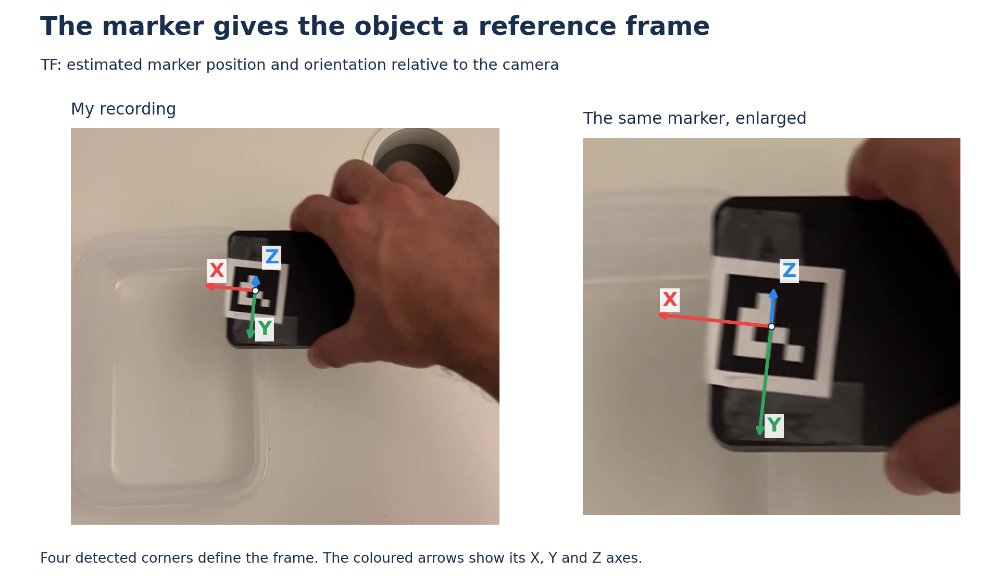
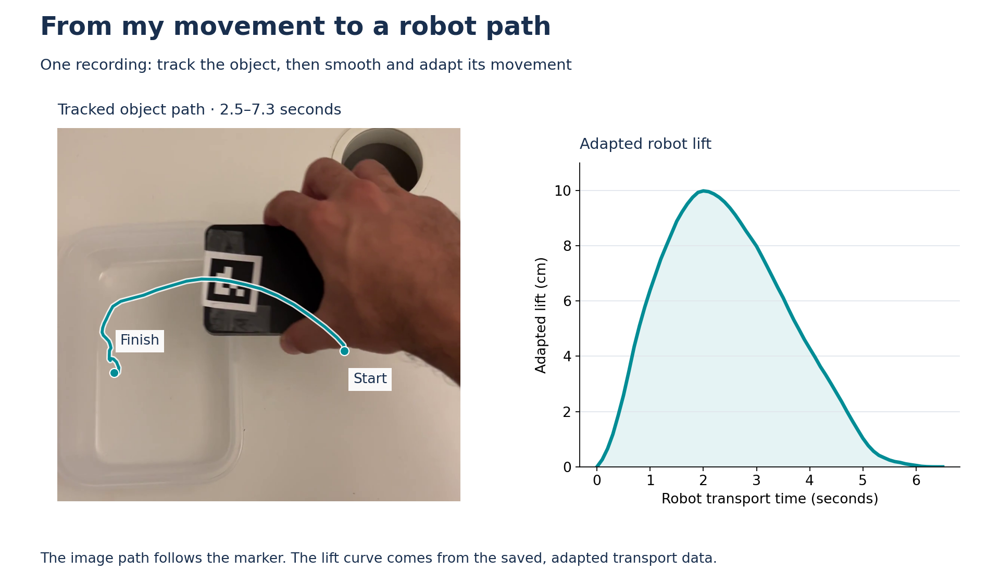
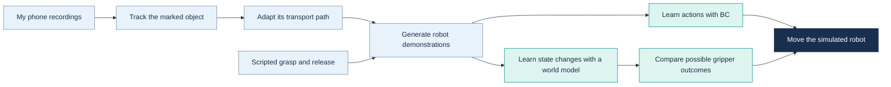
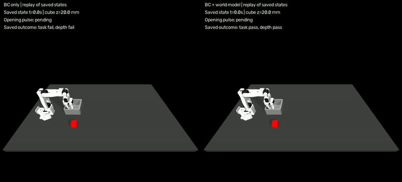
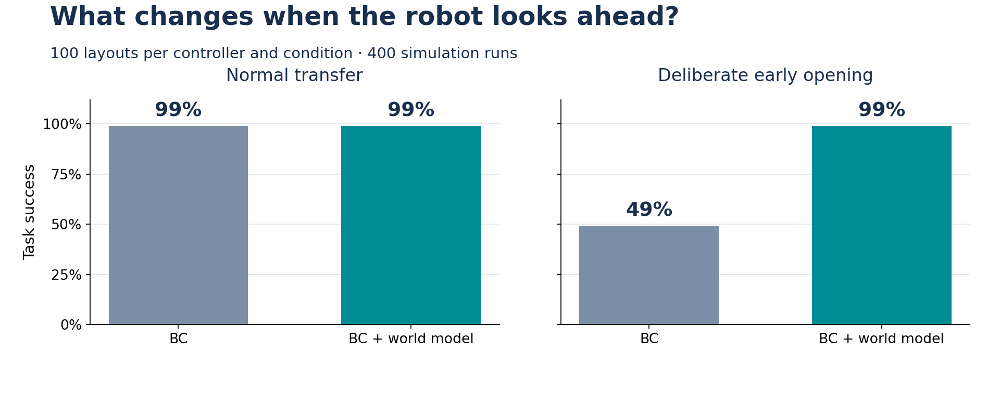

# Phone to Robot Learning

**From five phone recordings to a simulated robot that learns to pick, carry and place.**

I recorded myself moving an object into a container, then used those movements to teach a simulated SO-100/101 arm. A learned policy chooses the robot's actions; a small world model helps it decide when to keep holding the object.

**The result: 99% task success across 100 tested starting layouts.** When I deliberately introduced an early-opening command, adding the world model raised task success from **49% to 99%**.



*My recorded movement on the left; a learned robot transfer on the right. The images show separate examples.*

[Data preprocessing](#1-data-preprocessing) · [From movement to demonstrations](#2-the-middle--turning-movement-into-robot-demonstrations) · [Why the world model matters](#3-why-the-world-model-matters) · [Try it](#try-it)

## 1. Data preprocessing

### Start with a movement I recorded

I filmed five short videos of myself picking up an object, carrying it and placing it in a container. I attached an **ArUco marker**—the black-and-white square—to give the tracking code a consistent reference on the object.

The marker's four corners let me estimate both **where the object is and how it is oriented** relative to the camera. The coloured axes below show the marker's local coordinate frame. Its transform, or **TF**, describes its position and orientation relative to the camera, so movement can be described in coordinates rather than just pixels.



*Axes estimated from the detected marker corners using the same camera settings as the preprocessing pipeline.*

### Turn the footage into a usable path

I selected the part of each recording where I moved the object. The pipeline then tracked the marker, estimated its movement in 3D, smoothed small fluctuations and adapted the path to the robot's workspace and pace.



*The line follows the marked object, not a separately tracked hand. The lift curve is the adapted robot path from the same recording.*

These are the scripts behind the preparation, in the order they are used:

| Step | What I did | Script |
|---|---|---|
| Track the object | Find the marker corners in about ten frames per second and save their positions. | [track_marker.py](scripts/track_marker.py) |
| Select the movement | Keep the manually chosen interval from pickup through placement. | [select_movement.py](scripts/select_movement.py) |
| Estimate the path | Turn the marker corners into estimated 3D positions relative to its starting frame. | [estimate_pose.py](scripts/estimate_pose.py) |
| Smooth and adapt | Smooth the path, adjust the lift and travel direction, and retime it for the robot. | [make_transport.py](scripts/make_transport.py) |
| Prepare all five videos | Run the same steps using the saved start and end times for each recording. | [prepare_recordings.py](scripts/prepare_recordings.py) |
| Create robot examples | Add robot approach, grasp, placement and release movements around the phone-derived transport. | [generate_demo.py](scripts/generate_demo.py) |
| Add starting-position variations | Generate more examples from the training recordings while keeping their source labels. | [generate_dataset.py](scripts/generate_dataset.py) |

Three recordings supply training examples, one is used for validation, and one is reserved for testing. The generated variations stay with their original recording. Before learning, numerical inputs are scaled using training data only.

## 2. The middle — turning movement into robot demonstrations

The phone supplies the **shape of the transport movement**. Scripted robot actions provide the approach, grasp and release needed to turn that path into a complete demonstration.

I then train **behavioral cloning (BC)**: a policy that learns actions from those demonstrations. During evaluation, it reads the current robot and object measurements, chooses movement and gripper commands, and updates its choices as the scene changes.



[Watch a successful learned-policy rollout](docs/assets/learned-robot-transfer.mp4)

Across **100 tested starting layouts**, the learned policy achieves **99% task success**. The robot is choosing actions from its current measurements; it is not replaying the phone video frame by frame.

[How the policy is trained](scripts/train_policy.py) · [Evaluation details](docs/phone-only-confirmation.md)

## 3. Why the world model matters

Learning an action is useful. Predicting its consequences gives the robot another way to choose.

The **world model** learns from simulated examples of actions and what happened next. During a transfer, it looks ahead at three gripper choices: follow the policy, open, or close. A simple scoring rule compares the predicted outcomes and helps select the gripper command. The BC policy continues to move the arm.

To test this, I deliberately requested an opening while the robot was carrying the cube. Would the controller follow the request and drop it, or keep holding it until placement?



*One paired example from the deliberate early-opening test. The animation replays the saved simulation states.*



| Test | BC | BC + world model |
|---|---:|---:|
| Normal transfer | **99%** | **99%** |
| Deliberate early-opening request | **49%** | **99%** |

Each result covers **100 layouts**: two controllers, two conditions, **400 simulation runs** in total. The same trained models and settings are used throughout.

The world model's contribution here is clear: **it preserves the successful transfer when an early-opening command would otherwise interrupt it.** Normal-transfer success stays the same.

[Results and evaluation protocol](docs/phone-only-confirmation.md) · [How the world model selects gripper actions](docs/world_model_control.md)

## Earlier work: teleoperation integration, deferred

A separate [BC/DAgger lab](https://github.com/yiannisls/so101-behavioral-cloning) achieved **97% success in its original setup** and **82% with a shifted obstacle**, each measured over 100 runs. These use a different task setup from the phone-data controller presented here.

An integration pilot combined one human approach with phone-derived transport and scripted release. It completed a transfer but failed the contact-depth check. This integration is deferred and has not entered policy training.

[Archived integration pilot](docs/phone-lab-pilot.md) · [Data compatibility findings](docs/data-compatibility.md)

## Try it

The [guided walkthrough](docs/walkthrough.md) explains installation, simulator setup and downloading the saved artifacts. The public artifact upload is still pending; [release instructions](docs/publishing.md) describe the prepared package.

With the environment and artifacts ready, run a normal transfer and the protected early-opening example:

```bash
python scripts/evaluate_model_control.py --mode bc --video --out work/first-bc
python scripts/evaluate_model_control.py --mode wm --stress-open --video --out work/first-wm-opening
```

Each run saves a video and its results. Use a new output folder when repeating a run.

[Project map](docs/project-map.md) · [Design notes](docs/design_notes.md) · [Source acknowledgements](THIRD_PARTY.md)
