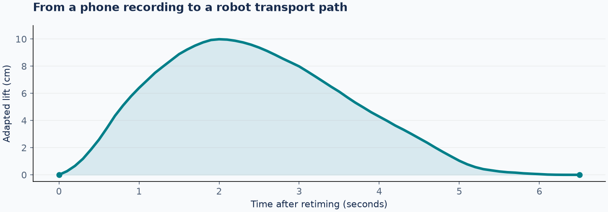
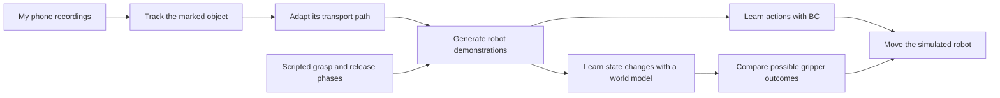
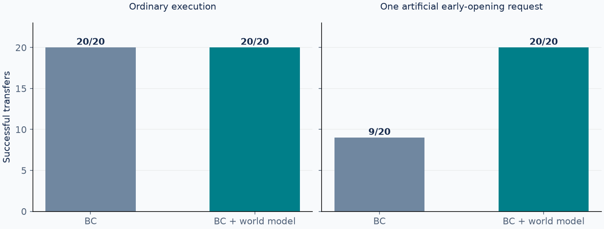

# Phone to Robot Learning

**Teaching a simulated robot to move an object using personally recorded phone videos.**

The internship challenge asks applicants to collect their own data and use it to drive a robot in simulation. I started with five phone videos of a simple manipulation task: pick up a marked object, carry it, and place it in a container. The aim is to transfer useful information from that human movement to a robot, then test what the robot actually learns.


*Left: one of my original recordings, with an ArUco marker attached to the object. Right: the learned policy moving a cube with the simulated SO-100/101 arm. These are separate examples, not synchronized frames.*

**Current result:** the phone-derived policy completes 20/20 transfers in the saved development comparison. A learned world model also helps reject a deliberately early gripper-opening command. The next experiment will test how phone-derived motion can complement my robot teleoperation demonstrations.

[See the result](#3-the-result--testing-the-robot) · [Understand the pipeline](#2-the-middle--turning-movement-into-robot-demonstrations) · [Run it](#run-the-project) · [Read the code](docs/project-map.md)

## 1. The start — collect a small, personal dataset

The starting point is an ordinary phone recording, rather than a robot demonstration. A black-and-white **ArUco marker** makes the object's movement easier to track: its four corners can be detected in each usable frame.

For each video, I select the interval covering the manipulation. The code tracks the marker, estimates its pose, smooths the motion, and adapts the path to the simulator's scale and direction.



*Example from IMG_5539. This is the path after smoothing, scaling and retiming for the robot. It is an approximation based on provisional camera calibration.*

The five recordings stay separated by source: three for training, one for validation and one reserved for testing. Starting-position variations are generated only from the three training recordings. **More simulated variations do not mean more independent real recordings.**

## 2. The middle — turning movement into robot demonstrations

A phone video shows how the object travels. It does not provide the robot commands needed to approach, grasp, or release it. To create the first robot dataset, the recorded transport path is combined with scripted approach, grasp, placement, release and retreat phases.



### Learning the actions: behavioral cloning

**Behavioral cloning (BC)** learns by example. Given the current robot and object measurements, a small neural network predicts upcoming movement and gripper commands. During execution, the robot follows a few commands, receives updated measurements, and predicts again.

The demonstrated trajectories teach the policy; the policy then chooses its own actions during evaluation. The current controller uses simulator state measurements. Camera and language inputs are planned as a possible later extension.

### Looking ahead: the world model

The **world model** learns to answer: “Given this state and this action, what state comes next?” It is trained on recorded simulator transitions, including training-only branches that try alternative actions.

During control, BC proposes the movement. The world model predicts what might happen under three gripper choices: follow BC, open, or close. A task-specific scoring rule compares those predictions over half a second, and the robot executes the first selected command before observing again.

The transition predictions are learned. The candidate choices, scoring rule and activation conditions are hand-written design decisions. This controller currently assists the gripper; BC supplies the arm movement.

## 3. The result — testing the robot

To test whether looking ahead changes behavior, one experiment deliberately requests opening while the cube is being carried. This is a controlled error injection, rather than a naturally occurring failure in every rollout.


*Left: BC receives the opening request and drops the cube. Right: the model-assisted controller rejects the request and completes the transfer. The animation replays saved simulator states from one paired example.*



| Phone-project experiment | BC | BC + world model |
|---|---:|---:|
| Ordinary execution | 20/20 | 20/20 |
| One artificial early-opening request | 9/20 | 20/20 |

These are **80 controller runs across 20 saved development layouts and two conditions**. The revised selector was checked on previously inspected layouts. It made no changes during ordinary execution and rejected one injected request in each protected stress trial. The counts were reproduced with the saved checkpoints.

This establishes a useful result for one specific disturbance. It does not establish general robustness: the same cube and scene were used, a simple rule could also address this opening error, and simulated grip forces remain unrealistically high. The ordinary experiment shows no success-rate improvement from adding the world model.

[Control method and limitations](docs/world_model_control.md) · [Reproduction evidence](docs/reproduction.md)

## What worked, and what still needs work

- **Personal footage contributes to control.** Its transport paths become part of the demonstrations used to train the robot policy.
- **Alternative-action examples help the world model.** In selected validation probes, its half-second cube prediction error after a changed gripper request fell from 10.32 mm to 1.15 mm. This is prediction error, not a task-success score.
- **Grasp and release need robot-specific information.** The phone dataset currently relies on scripted examples for these phases, which motivates incorporating human teleoperation.
- **Physics and generalization remain limitations.** Large contact-force peaks, approximate camera calibration, a small real dataset and a narrow task prevent broader claims.

[Prediction experiments](docs/world_model_v2_results.md) · [Gripper investigation](docs/gripper_experiments.md)

## 4. The next step — bring in human robot demonstrations

Alongside this project, I collected keyboard teleoperation demonstrations in the simulator and trained a BC policy with **DAgger**, where human takeovers provide corrective examples. That separate lab achieved **97/100 successes in its original distribution and 82/100 with shifted obstacles**. It provides a working robot-demonstration baseline; no further DAgger collection is currently planned.

Those results come from a different task setup and cannot be compared directly with the phone project's 20-layout scores. The compatibility check found different bin positions, gripper execution and movement-label definitions. The datasets have not been combined.

**The next question is: can phone-recorded movement reduce the amount of robot teleoperation needed to learn the task?**

| Stage | Status |
|---|---|
| Collect phone recordings and extract motion | Complete |
| Generate demonstrations and train BC | Complete |
| Learn a state world model and test gripper decisions | Complete for the reported experiment |
| Check compatibility with human teleoperation | Initial comparison complete |
| Adapt phone demonstrations to the lab's task and action conventions | Next |
| Compare teleoperation-only, phone-only and combined training | Planned |
| Build visual action data and fine-tune a VLA | Optional later experiment |

The combined-data comparison will keep the existing source splits and baselines. Its outcomes will be reported whether or not adding phone data helps.

[Data compatibility findings](docs/data-compatibility.md) · [Separate BC lab](https://github.com/yiannisls/so101-behavioral-cloning)

## Run the project

Start with the [guided walkthrough](docs/walkthrough.md). It covers installation, the separately obtained HW3 simulator, artifact verification, evaluation and training in that order. The saved-model archive is prepared locally; its public GitHub Release upload is pending. [Artifact publication instructions](docs/publishing.md)

Once the environment, simulator and saved artifacts are available, run from the repository root:

```bash
python scripts/evaluate_model_control.py --mode bc --video --out work/first-bc
python scripts/evaluate_model_control.py --mode wm --stress-open --video --out work/first-wm-opening
```

Each new output folder contains measurements and a rollout video. Choose new folder names when repeating an experiment; existing runs are protected from overwriting.

For the implementation, follow the [project map](docs/project-map.md). Detailed assumptions, source-family boundaries and historical experiments remain in the [design notes](docs/design_notes.md) and linked experiment reports. Simulator provenance and redistribution details are recorded in [THIRD_PARTY.md](THIRD_PARTY.md).
