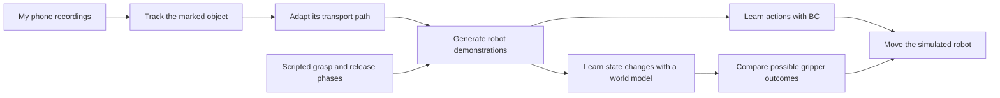
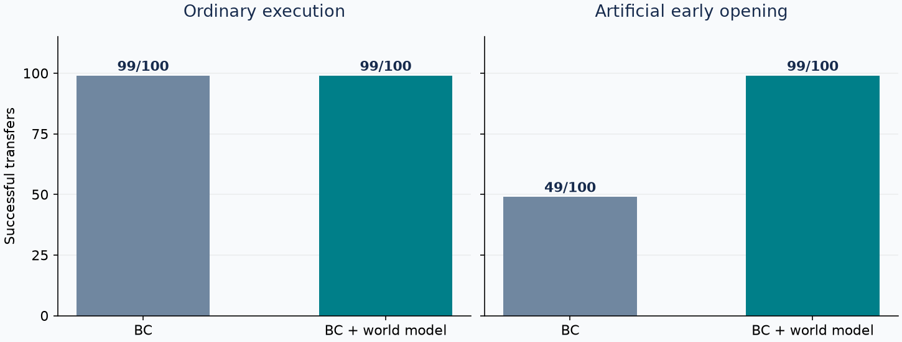
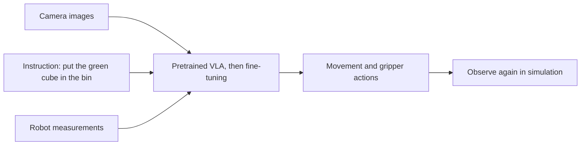

# Phone to Robot Learning

**Teaching a simulated robot to move an object using personally recorded phone videos.**

The internship challenge asks applicants to collect their own data and use it to drive a robot in simulation. I started with five phone videos of a simple manipulation task: pick up a marked object, carry it, and place it in a container. The aim is to transfer useful information from that human movement to a robot, then test what the robot actually learns.


*Left: one of my original recordings, with an ArUco marker attached to the object. Right: the learned policy moving a cube with the simulated SO-100/101 arm. These are separate examples, not synchronized frames.*

**Current result:** both frozen phone-derived controllers complete **99/100 transfers** in the expanded position evaluation. A learned world model also helps reject a deliberately early gripper-opening command. Under an artificial early-opening request, BC completes **49/100** and BC + world model **99/100**.

[See the result](#3-the-result--testing-the-robot) · [Understand the pipeline](#2-the-middle--turning-movement-into-robot-demonstrations) · [Next: multicube VLA](#4-next--choose-the-right-cube-from-a-language-instruction) · [Run it](#run-the-project) · [Read the code](docs/project-map.md)

## 1. The start — collect a small, personal dataset

The starting point is an ordinary phone recording, rather than a robot demonstration. A black-and-white **ArUco marker** makes the object's movement easier to track: its four corners can be detected in each usable frame.

For each video, I select the interval covering the manipulation. The code tracks the marker, estimates its pose, smooths the motion, and adapts the path to the simulator's scale and direction.


*Example from IMG_5539. This is the path after smoothing, scaling and retiming for the robot. It is an approximation based on provisional camera calibration.*

The five recordings stay separated by source: three for training, one for validation and one reserved for testing. Starting-position variations are generated only from the three training recordings. **More simulated variations do not mean more independent real recordings.**

## 2. The middle — turning movement into robot demonstrations

A phone video shows how the object travels. It does not provide the robot commands needed to approach, grasp, or release it. To create the first robot dataset, the recorded transport path is combined with scripted approach, grasp, placement, release and retreat phases.



### Learning the actions: behavioral cloning

**Behavioral cloning (BC)** learns by example. Given the current robot and object measurements, a small neural network predicts upcoming movement and gripper commands. During execution, the robot follows a few commands, receives updated measurements, and predicts again.

The demonstrated trajectories teach the policy; the policy then chooses its own actions during evaluation. The current controller uses simulator state measurements. The next experiment adds camera images and colour instructions in a separate multicube task.

### Looking ahead: the world model

The **world model** learns to answer: “Given this state and this action, what state comes next?” It is trained on recorded simulator transitions, including training-only branches that try alternative actions.

During control, BC proposes the movement. The world model predicts what might happen under three gripper choices: follow BC, open, or close. A task-specific scoring rule compares those predictions over half a second, and the robot executes the first selected command before observing again.

The transition predictions are learned. The candidate choices, scoring rule and activation conditions are hand-written design decisions. This controller currently assists the gripper; BC supplies the arm movement.

## 3. The result — testing the robot

To test whether looking ahead changes behavior, one experiment deliberately requests opening while the cube is being carried. This is a controlled error injection, rather than a naturally occurring failure in every rollout.


*Left: BC receives the opening request and drops the cube. Right: the model-assisted controller rejects the request and completes the transfer. The animation replays saved simulator states from one paired example.*



| Phone-project experiment, 100 layouts | BC | BC + world model |
|---|---:|---:|
| Ordinary execution | 99/100 | 99/100 |
| One artificial early-opening request | 49/100 | 99/100 |

These are **400 controller runs across 100 layouts and two conditions**, with frozen checkpoints and controller settings. The suite was expanded from 20 to 100 positions; the first 20 are retained and counted once. Both controllers miss the initial grasp on one layout. In the 99 lifted stress trials, the model-assisted controller rejects every injected opening request. No ordinary interventions occur.

[100-layout protocol and outcomes](docs/phone-only-confirmation.md). Earlier development results remain available in the historical reports.

This establishes a useful result for one specific disturbance. It does not establish general robustness: the same cube and scene were used, a simple rule could also address this opening error, and simulated grip forces remain unrealistically high. The ordinary experiment shows no success-rate improvement from adding the world model.

[Control method and limitations](docs/world_model_control.md) · [Reproduction evidence](docs/reproduction.md)

## What worked, and what still needs work

- **Personal footage contributes to control.** Its transport paths become part of the demonstrations used to train the robot policy.
- **Alternative-action examples help the world model.** In selected validation probes, its half-second cube prediction error after a changed gripper request fell from 10.32 mm to 1.15 mm. This is prediction error, not a task-success score.
- **Grasp and release need robot-specific information.** The phone dataset currently relies on scripted examples for these phases; the contribution of the footage is the transport movement.
- **Physics and generalization remain limitations.** Large contact-force peaks, approximate camera calibration, a small real dataset and a narrow task prevent broader claims.

[Prediction experiments](docs/world_model_v2_results.md) · [Gripper investigation](docs/gripper_experiments.md)

## 4. Next — choose the right cube from a language instruction

The next experiment uses the HW3 multicube scene: red, green and blue cubes with shuffled positions and a varying bin position. The task is to follow an instruction such as **“Put the green cube in the bin.”** This makes the requested object part of the task, rather than always moving the same cube.

**Status: planned. No VLA has been fine-tuned or evaluated in this project yet.** The 99/100 result above belongs to the state-based, single-cube experiment and does not predict performance here.

| What the VLA receives | What it should learn |
|---|---|
| Simulator camera views | Locate the cubes, robot and bin |
| “Put the green cube in the bin” | Select the requested colour |
| Robot measurements, such as joints and gripper opening | Choose movement and gripper commands |



### Keep the personal phone data central

The planned dataset will adapt the recorded transport paths to a selected cube and the bin, with the robot-specific approach, grasp and release phases documented separately. Successful demonstrations must be verified in the multicube scene before use. Existing phone footage supplies motion; it does not contain robot action labels or examples of selecting coloured cubes from language.

For each accepted robot demonstration, save synchronized images, robot measurements, action labels and a colour instruction. The existing state-only recordings do not already provide that visual dataset. Rendered simulator images will be labelled as simulated or reconstructed, rather than as direct phone-camera visual transfer.

### Which model?

**LeRobot is the training and dataset framework, not a separate VLA model.** The first practical candidate is [SmolVLA](https://huggingface.co/docs/lerobot/main/smolvla), a 450-million-parameter pretrained model. [π₀.₅](https://huggingface.co/docs/lerobot/main/pi05) is another candidate if compute and integration time allow. Both require adapting the data and action interface to this simulator; neither has been tested here.

**Local hardware check:** the RTX 4060 Laptop GPU (8 GB) passes CUDA and a small BF16 training check. A separate compatible LeRobot environment is installed and passes SmolVLA/LoRA import and CUDA checks. A real SmolVLA training-memory test is still pending. [Setup findings](docs/vla-setup.md)

The immediate priority is a reliable dataset. First inspect one complete image–instruction–action episode, then choose the training configuration and GPU. A larger model alone does not establish better results on this task.

### How the experiment will be evaluated

Use held-out layouts with balanced red, green and blue targets. Test the same layout with different colour instructions to check whether actions follow the instruction. Report correct-cube placement, wrong-cube selection, and grasp/release failures separately. Training, validation and test phone families remain separate, including generated descendants; normalization uses training examples only.

| Stage | Status |
|---|---|
| Phone-derived BC + world model, 100-position evaluation | Complete: 99/100 ordinary transfers for both |
| Inspect one synchronized multicube visual demonstration | Next |
| Generate and review balanced colour-conditioned demonstrations | Planned |
| Convert the verified dataset and fine-tune a pretrained VLA | Planned; model and GPU not finalized |
| Evaluate language selection and manipulation on held-out layouts | Planned |
| Resolve contact-physics limitations | Open |

The existing BC/world-model checkpoints and results remain the completed baseline. The current world model is not yet integrated with a VLA.

### Earlier work: teleoperation integration, deferred

A separate [BC/DAgger lab](https://github.com/yiannisls/so101-behavioral-cloning) achieved 97/100 original and 82/100 shifted-obstacle successes. Those are a different task setup and are not results of this phone-data controller. An integration pilot combined one human approach with phone-derived transport and scripted release; it completed a transfer but failed the contact-depth check. This integration is deferred and has not entered policy training.

[Archived integration pilot](docs/phone-lab-pilot.md) · [Data compatibility findings](docs/data-compatibility.md)

## Run the project

Start with the [guided walkthrough](docs/walkthrough.md). It covers installation, the separately obtained HW3 simulator, artifact verification, evaluation and training in that order. The saved-model archive is prepared locally; its public GitHub Release upload is pending. [Artifact publication instructions](docs/publishing.md)

Once the environment, simulator and saved artifacts are available, run from the repository root:

```bash
python scripts/evaluate_model_control.py --mode bc --video --out work/first-bc
python scripts/evaluate_model_control.py --mode wm --stress-open --video --out work/first-wm-opening
```

Each new output folder contains measurements and a rollout video. Choose new folder names when repeating an experiment; existing runs are protected from overwriting.

For the implementation, follow the [project map](docs/project-map.md). Detailed assumptions, source-family boundaries and historical experiments remain in the [design notes](docs/design_notes.md) and linked experiment reports. Simulator provenance and redistribution details are recorded in [THIRD_PARTY.md](THIRD_PARTY.md).
