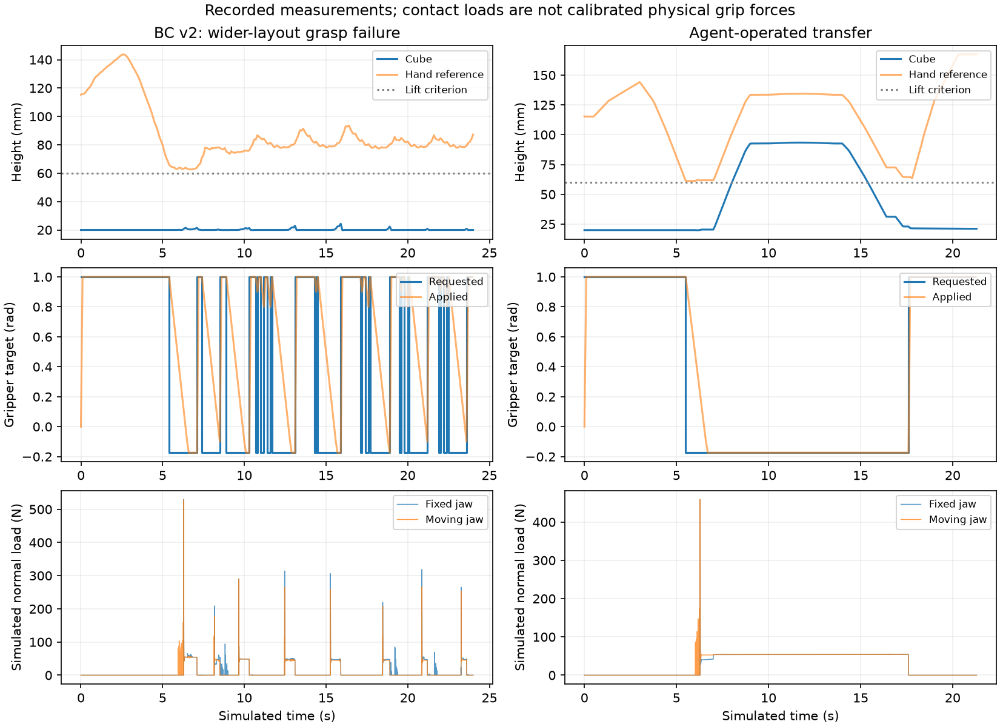

# Agent-operated grip recordings and BC v2

These notes preserve the earlier experiment. The subsequent online gripper-control
experiment, both controller revisions and all outcomes are documented in
[world_model_control.md](world_model_control.md).

This experiment collected 13 agent-operated simulator recordings and trained a
separate BC policy on the existing phone-derived dataset v2. The recordings are
diagnostic data; none entered policy or world-model training. No human keyboard
teleoperation was collected in this experiment.

## Recordings

`data/teleoperation/agent_v1/` contains 2,025 control transitions at 10 Hz and
101,250 physics samples at 500 Hz. Each episode has both NPZ and Zarr files.

- `force_trials/`: twelve executions of the three original training-family
  command sequences, with jaw torque limits of 3.5, 1.0, 0.5 and 0.3 N m.
  Origin: `agent_operated_saved_commands`. Successful and failed trials remain.
- `observed_transfer/`: one 213-action transfer operated through an agent command
  interface. The agent inspected the measured hand/cube states between stages,
  including an extra lowering adjustment before release. Origin:
  `agent_supervised_command_interface`. This was not human keyboard operation.
- `manifest.json`: origins, unassigned splits, counts, per-file hashes and checks.

The observed transfer lifted the cube to 93.4 mm, released it into the bin and
retreated. Its maximum cube penetration was 0.836 mm; worst jaw normal-load peak
was 459.4 N. Replay reproduced all qpos, qvel and physics samples exactly.
The verification is saved in `results/agent_gripper_v1_verification/`.

| Torque limit | Task completions / 3 | Task and depth passes / 3 |
| --- | ---: | ---: |
| 3.5 N m | 3 | 3 |
| 1.0 N m | 1 | 0 |
| 0.5 N m | 0 | 0 |
| 0.3 N m | 0 | 0 |

Reducing torque alone did not provide reliable lifting with these motions.
At 1.0 N m, one trial reached the bin but penetrated by 13.4 mm and recorded a
1,030.5 N spike. A smaller motor limit does not guarantee smaller collision loads.
The retained 3.5 N m trials had roughly 54 N median jaw loads during elevated
two-jaw contact. These measurements describe this particular simulation; they
do not identify a minimum physical grip force. The existing 1 rad/s closing rate
and +/-3.5 N m actuator limit remain the comparison settings.

Reproduce the command-sequence diagnostics into a new directory:

```bash
python scripts/collect_agent_grasps.py --out work/agent-grip-repeat --zarr
```

## Zarr format and lab compatibility

Every `episode.zarr` has current states in `data/`, requested commands in
`data/actions`, corresponding next states in `next/`, and one episode boundary
in `meta/episode_ends`. Full initial integration state and 500 Hz force/motion
samples are also retained. State/action alignment is explicit:
`data[t] + actions[t] -> next[t]`.

The array names include the lab's `state_ee`, `state_cube`, `state_joints`,
`state_gripper` and `action_gripper`. The homework's `hw3.dataset.load_zarr`
successfully loads the exported arrays. We checked every exported current/next
state, action and physics sample against its NPZ source with exact equality.
Copied files were subsequently checked against their saved hashes.

The action interface is a mocap-target increment plus a requested native gripper
target. It is not a displacement from the measured hand position. Lab-loader
compatibility does not make different action interfaces interchangeable.

The two existing lab raw stores were inspected without modification. One was
empty; the other contained 35 nearly stationary samples with no force traces.
They provided a format reference, not useful new grasp supervision.

## Policy comparison

BC v2 uses the preserved 63 training episodes and 9,529 transitions from
`data/demonstrations_v2/`, generated with the 1 rad/s closing profile. It uses the
same 24,352-parameter architecture, seed 7 and 300-epoch training procedure as BC
v1. Validation imitation loss selected epoch 127 before the new policy rollouts.
Validation position MAE is 1.000 mm; gripper prediction accuracy is 99.75%.
These imitation metrics measure agreement with teacher states, not task success.

| Policy and position suite | Tasks | Tasks and depth passes | Worst depth | Worst jaw peak |
| --- | ---: | ---: | ---: | ---: |
| BC v1, original positions, 1 rad/s | 20/20 | 20/20 | 1.497 mm | 499.3 N |
| BC v2, same original positions | 20/20 | 20/20 | 1.583 mm | 1,058.6 N |
| BC v1, wider positions | 18/20 | 16/20 | 34.316 mm | 1,179.7 N |
| BC v2, same wider positions | 19/20 | 19/20 | 1.640 mm | 865.4 N |

Original positions use seed 20261007 and x offsets [-25, 25] mm, y offsets
[-15, 25] mm. Wider positions use seed 20261008 and x offsets [-40, 40] mm,
y offsets [-30, 40] mm. The wider suite was specified before either run, and its
positions are identical for both policies. These are development comparisons,
not final held-out tests. Only cube starting position varies.

BC v2 completed the validation transfer in 131 control steps, versus 212 for BC
v1 at 1 rad/s. Its validation peak was 735.9 N versus 425.7 N. BC v2 is a useful
task-performance candidate; it is not a demonstrated force-control improvement.
Neither checkpoint was replaced and script defaults retain BC v1.

The remaining BC v2 failure, wider `layout_17`, is a missed lift followed by
36 switches between opening and closing requests. The cube never exceeded
24.41 mm at control samples. Its y offset is 35.78 mm, about 10.78 mm beyond the
training augmentation range. The trace suggests a recovery-data gap, but does
not isolate its cause. No extra training was performed on this failed position.



## Reproduce and continue

From the project root, with the homework Python environment active and
`ROBOT_LEARNING_HW3` set, choose new output folders:

```bash
python scripts/train_policy.py --data data/demonstrations_v2 --epochs 300 --out checkpoints/bc-v2-repeat
python scripts/evaluate_policy.py --checkpoint checkpoints/bc_v2/policy.pt --gripper-close-rate 1 --video --out work/bc-v2-validation
python scripts/evaluate_layouts.py --checkpoint checkpoints/bc_v2/policy.pt --gripper-close-rate 1 --out work/bc-v2-layouts
python scripts/evaluate_layouts.py --checkpoint checkpoints/bc_v2/policy.pt --gripper-close-rate 1 --seed 20261008 --range-x -0.04 0.04 --range-y -0.03 0.04 --out work/bc-v2-broader
```

The machine-readable comparison is `results/agent_gripper_policy_v1.json`.
Individual rollouts are in `results/bc_v2_validation/`, `results/bc_v2_layouts/`,
`results/bc_v1_broader/` and `results/bc_v2_broader/`.

Later human recordings can use:

```bash
python scripts/record_gripper.py --out data/teleoperation/human-001 --zarr --video
```

Keep holds, slips and failed approaches. Before any training inclusion, assign
whole recording families to splits and screen complete successful transfers for
BC. Failure transitions can support world-model training once their physics
profile and split are fixed. The phone source split remains three training
recordings, IMG_5542 validation and IMG_5543 test; the test source was not used
for this policy experiment. All 130 existing v1/v2 demonstration files, BC v1
and both world-model checkpoints passed preservation checks.

The world model still predicts state transitions separately from control. The
next control experiment is a limited comparison of gripper action choices using
the second world model, with BC supplying movement commands. It needs a
separate frozen evaluation protocol; these results do not claim model-based
control. The project remains state-based BC rather than a VLA.
