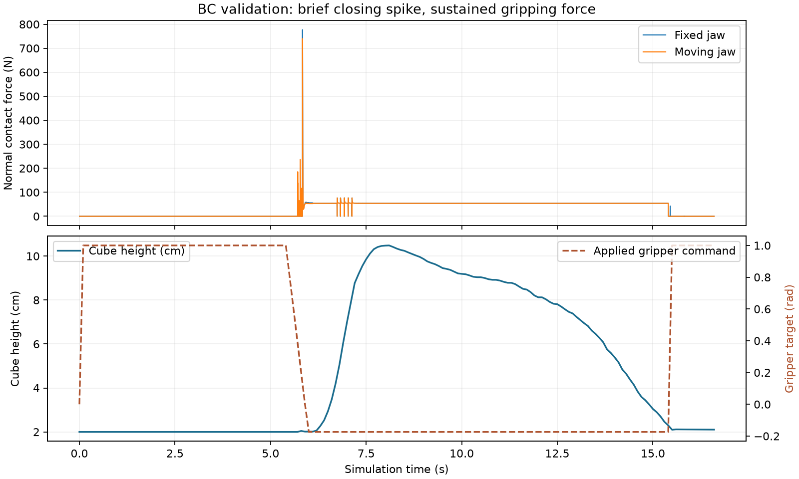

# BC baseline: 20 starting positions

The fixed `bc_v1/policy.pt` checkpoint, selected at epoch 100 using validation
imitation loss, completed 20/20 new starting-position rollouts. All 20 also passed
the 2 mm maximum cube-contact penetration check. No task failure appeared in
this suite. The checkpoint and demonstrations were unchanged during evaluation.

## Scope

- Random seed: 20261007; 20 offsets saved before evaluation in
  `results/bc_v1_layouts/layouts.json`.
- Cube offsets: x in [-25, 25] mm, y in [-15, 25] mm; within the training
  augmentation range. None exactly matched a training start. The closest pair
  was 0.654 mm apart, so this is a local generalization check.
- Same cube, bin, contact parameters and robot as training; MuJoCo 3.14.0.
- The held-out IMG_5543 recording was not used in policy evaluation or tuning.
- This suite is available for development. If used to choose changes, it is
  no longer a fresh final evaluation; retain a separate final suite.

## Measurements

| Measurement | Result |
| --- | --- |
| Task success | 20/20 |
| Task success plus contact-depth check | 20/20 |
| Completion time | 12.5 to 17.5 simulated seconds |
| Largest cube penetration | 1.492 mm |
| Largest fixed-jaw normal force | 800.6 N |
| Largest moving-jaw normal force | 889.5 N |

Each layout folder contains the video, T actions with T+1 robot observations,
physics contact samples and a result JSON. All traces passed finite-data,
state/action alignment, time-step count and checkpoint consistency checks.
The aggregate report is `results/bc_v1_layouts/summary.json`.

The batch initially stopped after eight completed runs because argparse rejected
a negative coordinate in scientific notation. Decimal formatting fixed the
argument parsing, with exact coordinate round trips. The remaining runs were
resumed; the eight completed runs were preserved.

## Gripper diagnosis

The following plot comes from the separate, earlier validation rollout in
`results/bc_v1_validation/`, not an average over the 20 layouts.

In that validation rollout, both force peaks occurred at 5.836 seconds during
closing, before the cube was lifted. Forces exceeded 100 N for 18 physics steps
(0.036 seconds). Much of the subsequent grasp was around 54 N per jaw. This is
both a brief closing spike and a sustained gripping-force issue.

The model's jaw position actuator already limits torque to +/-3.5 N m. The
2 rad/s command-rate limit slows closing but does not directly limit contact
force. A next experiment is to reduce the jaw torque limit and measure force,
slipping and task success on validation data. The cause and remedy must be
tested; the present measurements alone do not prove a particular fix.

If the chosen physics settings change, generate a new dataset version under
those settings before training the world model. Preserve the present dataset,
checkpoint and evaluation as the baseline.
