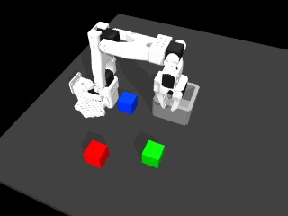
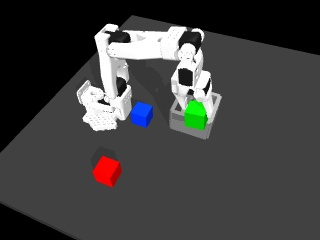

# A fixed camera view for visual demonstrations

The original camera spends much of its image on empty table and background. The new workspace preset makes the cubes, gripper and bin larger at the same 320 × 240 image resolution. It changes rendering only: the recorded robot states, actions, cube motion and contact results match the earlier candidate exactly.

Original scene view:


Fixed workspace view:



During phone-derived transport:



[Watch the workspace-view episode](assets/camera-workspace.mp4) · [Measurements and camera settings](camera-framing.json)

## What changed

`record_visual_episode.py --framing workspace` overrides the selected named camera in that environment instance. It does not edit the external simulator XML or any physics parameter. The default remains `--framing scene`, preserving earlier camera behavior.

| Camera setting | Workspace preset |
|---|---|
| World position | [-0.15, 0.15, 0.50] m |
| Fixed look-at point | [-0.29, 0.49, 0.06] m |
| Vertical field of view | 50 degrees |
| Image dimensions | 320 × 240 RGB |
| Motion | Fixed to the world; independent of instruction, target colour and cube motion |

The camera pose is set once before recording. `mj_camlight` updates camera transforms without an extra physics-forward call. The report stores its world position, orientation, field of view and preset name. These images are rendered simulation observations, not direct phone-camera views.

The view is intended to cover the manipulation area. Some upper-arm geometry is cropped during the final retreat; the hand reference point and all cube corners stay inside the frame on the measured episode. Future layouts still need their own coverage and occlusion checks.

## Measured comparison

The following numbers describe the largest contiguous visible region of each cube geometry in the **initial frame only**, measured with MuJoCo's segmentation render. Disconnected labels at unrelated mesh edges were excluded; the raw and reviewed diagnostics remain in the local output folder. These diagnostic masks are not training labels.

| Cube | Original visible component | Workspace visible component | Original bounding box | Workspace bounding box |
|---|---:|---:|---|---|
| Red | 159 pixels | 602 pixels | 15 × 13 px | 30 × 31 px |
| Green | 125 pixels | 541 pixels | 13 × 12 px | 25 × 31 px |
| Blue | 100 pixels | 430 pixels | 12 × 10 px | 22 × 27 px |

This is approximately 3.8–4.3 times the initial visible pixel area. Viewpoint and occlusion differ between the cameras, so these numbers are not a pure zoom factor and do not predict model accuracy.

Across all 252 recorded observations, the projections of all cube corners and the hand reference point remained in front of the camera and inside the image. The full cube-corner bounds were approximately x=[92.3, 211.3], y=[76.5, 187.6] pixels. Projection coverage does not prove continuous visibility through gripper/arm occlusion; start, carry and final frames were also inspected.

The new episode's `qpos`, `qvel`, robot inputs, actions, mocap targets, timestamps, cube states and phase labels match the earlier corrected episode exactly. Task completion and the unchanged 2 mm contact-depth check pass, with maximum target penetration **0.971 mm**. It still contains 251 actions and 252 observations, retains 24 of 46 phone-transport actions, and remains excluded from the training dataset. No new model was trained or evaluated by this camera change.

## Reproduce

From the project root with the [VLA environment](vla-setup.md), baseline artifacts and external HW3 dependency available:

```bash
export ROBOT_LEARNING_HW3=/path/to/hw3_imitation_learning
.venv-vla/bin/python scripts/record_visual_episode.py \
  --placement feedback --framing workspace \
  --source IMG_5539 --color green --out work/my-workspace-view
```

Use a fresh output folder. Expected output includes `camera_settings.framing: workspace`, `camera_settings.fixed_to_world: true`, `task_success: true`, `quality_pass: true`, 251 actions and 252 observations. Inspect your own values because versions/platforms can affect rendering and physics. The recorder saves an AVI preview; the linked public preview is an H.264 conversion of that recording.

Next: implement the [balanced collection pilot](visual-collection-plan.md). Keep the camera fixed across instructions, and verify framing again for each new geometry before accepting data.
