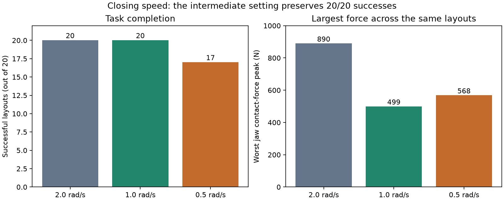

# Gripper experiments

> Historical commands: some plotting, diagnostic and older evaluation scripts in this report were removed during cleanup. Use [the current walkthrough](walkthrough.md) for runnable simulation commands. The original scripts remain in Git commit `e686ed4`. Saved measurements and figures below are unchanged.

The selected candidate for the next dataset version is a **1.0 rad/s closing
target rate**, keeping the jaw actuator's existing +/-3.5 N m torque limit.
It retained 20/20 successes on the saved development layouts and reduced the
worst jaw contact-force peak from 889.5 N to 499.3 N (43.9%). This is a partial
improvement, not a claim that the simulated forces are physically calibrated.

The checkpoint was unchanged throughout. All recorded datasets, baseline results
and failed experiments are preserved. IMG_5543 was not used in these experiments.

## Validation experiments

Torque is the motor's rotational effort; the reported force is the normal contact
force summed over cube contacts for each jaw. They are different quantities.

| Torque limit (N m) | Closing rate (rad/s) | Task success | Worst jaw peak (N) |
| --- | --- | --- | --- |
| 3.5 | 2.0 | Yes | 777.0 |
| 3.5 | 0.5 | Yes | 264.3 |
| 1.0 | 2.0 | No | 210.9 |
| 1.0 | 0.5 | No | 217.3 |
| 0.3 | 2.0 | No | 129.3 |
| 0.3 | 0.5 | No | 64.1 |
| 3.5 | 1.0 | Yes | 425.7 |

The first six runs are in `results/gripper_torque_v1/`; the intermediate-rate
validation run is in `results/gripper_rate1_validation/`. The baseline repeat
reproduced every saved state and action exactly.

At 1.0 N m and 2.0 rad/s, the policy lifted the cube but requested opening before
reaching the bin. At 1.0 N m and 0.5 rad/s, it lifted the cube but did not complete
placement and release. The 0.3 N m runs did not lift the cube above 2.4 cm.
These are outcomes of the existing policy under changed actuator dynamics;
they do not establish that a retrained policy could never use lower torque.

## Same-layout comparison

After slower closing passed validation, it was evaluated on the original 20
development layouts. Its three failures motivated the intermediate 1.0 rad/s
experiment. Selection therefore uses development feedback, not a fresh final test.

| Closing rate | Task / contact-depth passes | Worst jaw peak | Largest cube penetration |
| --- | --- | --- | --- |
| 2.0 rad/s | 20/20 | 889.5 N | 1.492 mm |
| 0.5 rad/s | 17/20 | 568.4 N | 18.683 mm |
| 1.0 rad/s | 20/20 | 499.3 N | 1.497 mm |



The checkpoint hash and all 20 coordinates are identical across comparisons.
At 1.0 rad/s, completion took 12.2 to 21.7 simulated seconds, compared with
12.5 to 17.5 seconds for the baseline. The slower 0.5 rad/s setting failed on
layouts 13, 15 and 17; all three also failed the contact-depth check.

The original suite is in `results/bc_v1_layouts/`, slower closing in
`results/bc_v1_slow_close/`, and intermediate closing in
`results/bc_v1_rate1_close/`. Videos and physics traces are retained for every run.
The baseline evaluator and batch script were archived alongside their results.

## Reproduce and continue

Run from the project root with the homework environment configured:

```bash
python scripts/evaluate_policy.py --gripper-close-rate 1.0 --video --out results/my-rate1-validation
python scripts/evaluate_layouts.py --gripper-close-rate 1.0 --video --out results/my-rate1-layouts
```

Default execution still uses 2.0 rad/s for baseline reproduction; pass the new
rate explicitly. The existing demonstrations were also generated at 2.0 rad/s.
The next step is a separate dataset version generated at 1.0 rad/s before
training the world model. Do not silently mix these execution profiles.

Sustained squeezing forces remain a limitation. We have reduced impact peaks
while keeping development success; lower actuator torque would require further
demonstration/control adaptation and evaluation. A separate final evaluation is
still needed after model and controller choices are fixed.
