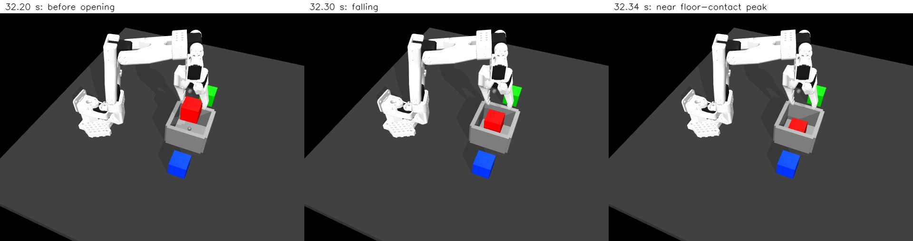

# Why the human action replay failed contact quality

The contact trace identifies the **5.049 mm penetration as cube/bin-floor contact after release**. The separate **90.51 N peak normal force occurs at a moving gripper pad during pickup**. These are different events and need separate treatment.

The instrumented run exactly reproduces the first replay's control arrays, physics arrays and rollout checksum. Logging changed no movement, gripper, orientation, force-limit or contact-solver settings. The outcome remains **task completed, quality failed**, with no training inclusion.

[Measured contact events and verification](human-contact-diagnosis.json) · [Original physics replay](human-physics-replay.md)



This closer diagnostic view renders saved simulated states without advancing physics. It is not a new training camera or an additional rollout. The last frame uses the saved post-step state near the peak; exact scalar contact measurements come from the live solver trace, rather than contacts recomputed for the image.

## Two events, two findings

| Event | Logged time | Contact pair | Penetration at that event | Normal force at that event |
|---|---:|---|---:|---:|
| Maximum penetration | 32.340 s | `red_box` / `bin_floor` | **5.049 mm** | 1.363 N |
| Maximum single-contact normal force | 15.376 s | `moving_jaw_pad_3` / `red_box` | 0.00972 mm | **90.513 N** |

Force values are per contact, not summed calibrated grip forces. The largest floor-contact force at any time was about 6.29 N, separate from the force at the depth peak. No force acceptability threshold has been established. Native jaw torque limits remain +/-3.5 Nm, with the original instantaneous gripper-target executor.

The pickup pad force still needs investigation even though jaw-pad penetration is small. Raising grip force would not address the identified landing event, and a small penetration value alone does not validate grip forces.

## The release sequence

At observation 322, just before the recorded opening request, the cube bottom is **69.3 mm above the bin floor**. Robot/cube force contact ends at approximately 32.214 s. Floor force contact begins around 32.328 s, then the penetration peaks at 32.340 s. Contact activity here uses a declared threshold of 1e-6 N. The hand stays near Z=0.1297 m while the cube falls.

| Nominal observation time | Original recorded cube-centre Z | Physics replay cube-centre Z |
|---|---:|---:|
| 32.2 s | 91.88 mm | 91.16 mm |
| 32.3 s | 53.49 mm | 48.14 mm |
| 32.4 s | 21.22 mm | 20.66 mm |

The original recording also shows the high release. That establishes that this demonstration's placement style includes a drop; it was not introduced solely by converting the movement labels. Exact motion still differs because original target commands and velocities were not recorded. The original store lacks physics-rate contact forces/depths, so the replay's measured 5.049 mm and 90.513 N values must not be attributed directly to the original human recording.

The traced sequence supports a landing-impact explanation: the hand has lost positive-force contact before the floor impact and does not descend with the cube. The cube ultimately settles correctly in the bin, so final task completion alone hides this contact-quality failure. There is no detected robot self-penetration in this replay.

## Reproduce the trace

From the project root, with the isolated environment and original external lab data available:

```bash
MUJOCO_GL=egl .venv-vla/bin/python scripts/replay_human_episode.py \
  --lab /path/to/so101-behavior-cloning \
  --episode 0 --contact-trace \
  --out work/my-human-contact-trace
```

Use a new output folder. The ordinary replay outputs remain available, with two additional files:

- `contacts.npz`: 82,175 target-contact rows in this measured run, including step-log time, action index, other geometry ID, depth and normal force, plus geometry names.
- `contacts.json`: peak-depth and peak-force contact descriptions and post-step state snapshots.

`summary.json` records whether tracing was enabled and its report checksum. Without `--contact-trace`, no contact trace files are written. Both modes use the same controller. Contact timestamps are logged after `mj_step`; the solver contact record and saved post-step state are described separately rather than pretending they are a recomputed geometrically identical snapshot.

The measured trace is in `work/human-contact-trace-20261015-01`, with verification and an exact script snapshot. The original run remains in `work/human-physics-replay-20261015-01`. The second run repeated the same case solely to add logging and verify identical physics; it is not a second independent successful trial or a policy-performance score.

## Next experiment

Keep the original human demonstration unchanged. Generate a separately labelled human-plus-script candidate that retains the human motion prefix, lowers the held cube near the bin floor, then opens gradually and retreats. Record the handoff, replaced actions and simulator-state feedback explicitly. That proposed correction has not been implemented or tested in this stage, and it must not silently run during a rollout labelled VLA alone.

Compare the corrected candidate against the retained original using the same depth threshold. Log pickup forces separately; a gentler landing would not establish that the 90.5 N pickup force is acceptable. Review those results before adopting examples or expanding to all 42 human episodes and the seven DAgger segments. No normalization, VLA training, held-out evaluation or data rewriting took place during this diagnosis.

Presentation explanation: “The robot completed the task, but detailed contact logging showed it dropped the cube from about 7 cm. I kept task success separate from contact quality, confirmed that the high release was present in the human recording, and identified pickup force as a separate limitation.”
