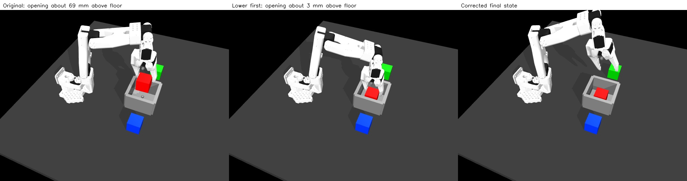

# Lower first, then open once

The corrected human-prefix replay completes the transfer and passes the existing depth/distractor/self-contact screen using **one instant opening request**. Maximum target penetration falls from **5.049 mm to 1.005 mm** in this training case. The gripper opens at approximately **3.0 mm cube-bottom clearance**, rather than approximately 69.3 mm above the bin floor.

This is a **human-plus-script demonstration diagnostic**, not a VLA rollout or an unmodified human teleoperation. No dataset or checkpoint was replaced, and the candidate is not accepted into training. Contact forces remain unvalidated.

[Measured comparison and verification](human-lower-first.json) · [Corrected physics video](assets/human-lower-first.mp4) · [Original contact diagnosis](human-contact-diagnosis.md)



The comparison picture uses saved simulated states and a closer diagnostic camera, with no physics stepping. Training images were not changed. The linked video records the actual corrected physics run.

## What changed

`replay_human_episode.py --placement lower-first --handoff-step 322` executes the original recorded actions 0–321, then replaces the final 16 recorded actions with the existing feedback placement teacher. The handoff is an explicit development choice for original training episode 0, based on the traced opening event. It is not an automatic detector for every recording or a held-out evaluation setting.

The placement teacher checks that the cube is lifted and near the bin, clears the rim while centring, lowers in at most 1 mm increments, stops near 3 mm floor clearance, opens once, retreats and settles. It retains the fixed hand orientation and native instantaneous gripper executor. The helper uses exact simulator cube/goal geometry; that privileged feedback belongs to demonstration generation and must not silently execute during a rollout labelled VLA alone.

The opening target is the original recorded request at action 322: approximately **0.400008 rad**. The holding target remains the previous recorded request, approximately **0.300008 rad**, until release. The helper receives `release_steps=1`, so its opening sequence contains only the final request, with no intermediate opening targets. The physical jaw still follows its native actuator dynamics.

The placement helper now accepts optional `open_grip` and `release_steps` parameters. Existing phone experiments keep their defaults and retain their historical behaviour. `--placement replay` remains the default human execution mode. No force limits, contact parameters, evaluation thresholds or original data were changed.

## Measured outcome: one paired training case

| Measurement | Original action replay | Lower-first variant |
|---|---:|---:|
| Task completed | Yes | Yes |
| Contact-quality screen | Failed | **Passed** |
| Maximum target penetration | 5.049 mm | **1.005 mm** |
| Release bottom-to-floor clearance | About 69.3 mm | **2.996 mm** |
| Maximum robot self-penetration | 0 mm detected | 0 mm detected |
| Maximum single target-contact normal force | 90.51 N | **97.92 N** |
| Executed actions / duration | 338 / 33.8 s | 460 / 46.0 s |
| Preserved recorded actions | 338 | 322 |
| Original tail actions replaced | 0 | 16 |
| Added scripted actions | 0 | 138 |
| Accepted into training | No | No |

The 138 scripted actions comprise 20 rim-clearance/centring steps, 82 lowering steps, **one release step**, 20 retreat steps and 15 settling steps. This changes motion, centring and duration together; it is not an isolated ablation of release height alone. The existing 2 mm target-depth threshold was applied over the entire run, including the preserved human prefix.

The corrected run's peak force is at `fixed_jaw_pad_1` against the red cube during release, approximately 42.45 seconds. The earlier 90.51 N moving-pad pickup event remains in the preserved prefix. A depth-screen pass does not certify either contact force. The outcome supports instant opening for this particular lowered placement, not a general guarantee about every object, layout or gripper setting.

This 46-second teacher diagnostic exceeds the proposed 40-second common BC/WM/VLA evaluation allowance. It is not a policy evaluation and contributes no score under that proposed benchmark. No VLA has learned this motion yet.

## Run the corrected version

From the project root with the isolated environment and external lab data:

```bash
MUJOCO_GL=egl .venv-vla/bin/python scripts/replay_human_episode.py \
  --lab /path/to/so101-behavior-cloning \
  --episode 0 --placement lower-first --handoff-step 322 \
  --contact-trace --out work/my-lower-first-replay
```

Use a fresh output folder. Expect `task_success: true`, `quality_pass: true`, `placement_completed: true`, `release_steps: 1` and 460 executed actions for this measured configuration. Inspect your own report; version/platform changes can affect contacts.

```bash
xdg-open work/my-lower-first-replay/rollout.avi
```

The output contains the usual replay arrays, video and report, contact tracing, and per-action phase labels in `rollout.npz`. These arrays describe executed target-delta commands; they are not automatically the `human_visual_v1` achieved-motion training format. No converted VLA training corpus, normalization or trained checkpoint is produced here.

For the untouched command sequence, omit the placement/handoff flags and use another output directory. Original output folders are protected. The handoff is rejected unless it identifies an opening increase, and existing validation IDs remain unavailable to this development replay.

## Verification and provenance

All 322 recorded prefix actions and 323 corresponding replay observations exactly match the retained original replay. The corrected sequence holds the same native grip request until the single release action, uses the original opening request afterward, keeps all movement commands <=12 mm, and retains aligned 10 Hz state/action records. The raw source-array checksums match the original recording.

The refactored default human replay exactly reproduces its earlier physical arrays and action labels, with the same task success and quality failure. A phone default-placement regression exactly reproduces its physical arrays/actions/labels and contact-depth result; RGB differences are at most one channel level. The 1,418 immutable baseline artifacts remain unchanged.

The measured corrected run is `work/human-lower-first-20261015-01`, including exact replay/helper script snapshots and verification. Default regressions are in `work/lower-first-regression-20261015-01`. The original run and all earlier results remain separate. The larger local artifacts are not in the existing baseline release archive; the small comparison report and preview media are included in Git.

## What remains

A [jaw-torque comparison](human-jaw-torque.md) now records the next check: 1 Nm loses the cube, while 2 Nm completes the transfer but increases the pickup contact peak. The default remains unchanged. Investigate pickup alignment/contact geometry and check more training examples before adopting a corpus. The explicit handoff for episode 0 cannot simply be copied to the other 41 recordings. The seven DAgger correction segments remain separate pending source/split review. If this hybrid data is later converted for VLA learning, preserve its human/script phase provenance and define a consistent action-label convention rather than merging the current arrays directly.

Presentation explanation: “Lowering before release reduced the contact-depth failure in one recorded training case. The opening command stayed instant and matched the original demonstration. I kept the original result, labelled the scripted replacement, and reported the remaining force and timing limitations.”
