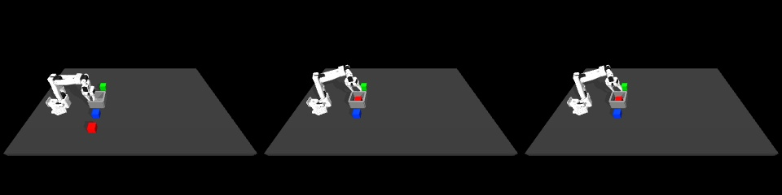

# Replay the recorded human actions under physics

A pose-reconstruction video loads every saved robot/object pose. This replay instead restores **only the starting configuration**, applies the recorded movement/gripper labels, and advances MuJoCo. Subsequent robot and cube motion comes from physics. No VLA or other learned policy chooses actions.

The first fixed-executor replay of human training episode 0 completed the transfer but **failed the contact-quality screen**: maximum target-cube penetration was 5.05 mm versus the declared 2 mm threshold. Both outcomes are retained. This is one diagnostic replay, not a learned-policy success rate or acceptance of the human dataset.

[Measured report and verification](human-physics-replay.json) · [Actual physics replay video](assets/human-physics-replay.mp4) · [Earlier reconstructed-pose video](human-visual-episode.md)



## Run it

From the challenge project root, using the isolated environment and your external lab checkout with its original raw/processed multicube stores:

```bash
MUJOCO_GL=egl .venv-vla/bin/python scripts/replay_human_episode.py \
  --lab /path/to/so101-behavior-cloning \
  --episode 0 \
  --out work/my-human-replay
```

Use a new output folder. To watch the resulting physics video on Linux:

```bash
xdg-open work/my-human-replay/rollout.avi
```

For the measured source and environment, expect 338 executed actions, `termination: null`, `task_success: true` and `quality_pass: false`. Contacts can vary with simulator/dependency changes; inspect your own report. The command saves `rollout.avi`, `rollout.npz`, `physics.npz` and `summary.json`. No checkpoint is loaded, normalization fitted or dataset modified.

## What the code does

`scripts/replay_human_episode.py` reuses the converter's read-only episode reader. The source list and 42-episode dataset remain fixed, and the recorded action labels must match the original processed lab store. Existing validation IDs are rejected before reading their data.

Initialization restores the six robot joints, all three cube poses and the bin position. Original velocities and mocap commands were not recorded: velocities are explicitly set to zero, and the initial measured hand position/orientation initializes the controller target. These assumptions make this an approximate action reconstruction rather than exact original teleoperation replay.

For every recorded action:

1. Add its measured XYZ displacement to the current hand target, matching the lab's `action_ee_xyz` execution rule.
2. Apply the recorded native gripper target directly, using the original actuator limits and no added closing-rate limiter.
3. Hold the initial target orientation fixed; the four-value action has no rotation channel.
4. Advance 50 physics steps of 0.002 seconds, then save the new simulated state and image.

There is no later pose restoration, scripted pickup/placement helper, retiming, action clipping beyond the native actuator behavior, extra settling tail or retry. Future recorded hand positions are used only afterward to measure trajectory error. These native lab execution settings differ from the proposed common BC/WM/VLA benchmark and do not create a new entry in its score table.

## First measured outcome

| Measurement | Result |
|---|---:|
| Training episode / target | 0 / red |
| Executed actions / observations | 338 / 339 |
| Physics samples | 16,900 |
| Nominal executed duration | 33.8 s |
| Task completion | Yes |
| Contact-quality screen | **Failed** |
| Maximum cube height | 92.54 mm |
| Final cube XY error, maximum axis | 2.65 mm |
| Final cube height | 21.00 mm |
| Final hand-to-cube distance | 111.11 mm |
| Stable final cube | Yes |
| Maximum target penetration | **5.049 mm** |
| Maximum robot self-penetration | 0 mm detected |
| Mean / maximum hand-path error | 4.11 / 9.97 mm |
| Peak single target-contact normal force | 90.51 N |
| MuJoCo version | 3.14.0 |

Task completion requires a lift above 60 mm, final cube XY within 40 mm of the bin, final cube Z between 15 and 50 mm, hand/cube separation above 70 mm, less than 5 mm movement over the final five control intervals, an open command above 0.4, and no bounds/numerical termination. Contact quality separately requires target penetration <=2 mm, no detected robot self-penetration and distractor motion <10 mm. The first run's distractor displacement was negligible.

Contact depths and normal forces are sampled at physics rate. The penetration peak occurred at approximately **32.34 seconds**; the force peak occurred at **15.376 seconds**. These are different events. The 90.51 N figure is the largest single contact-normal-force magnitude involving the target cube, not a calibrated total grip force. Force acceptability remains unvalidated.

A later nearby saved observation at 32.4 seconds shows cube/bin-floor contact. This is consistent with a late placement/release issue, but the saved control-rate snapshot does not identify the exact geometry responsible for the physics-rate penetration peak. Do not present that inference as an exact contact diagnosis. The next diagnostic should identify that peak contact before changing the controller or gripper settings; do not raise the depth threshold to make the result pass.

## Verification and boundaries

The saved executed actions exactly match the converted human episode's labels. Timing, target-delta alignment, finite values, 339 video frames and 10 Hz playback were checked. Simulated hand motion differs from pose reconstruction, as expected. Held-out IDs and existing output folders are protected. The original recordings, earlier converted candidates, learned controllers and evaluation results remain unchanged; this candidate is still excluded from training.

The raw measured run is retained in `work/human-physics-replay-20261015-01`, including the original summary, arrays, physics samples, video, verification report and exact script snapshot. The Git report adds post-run verification and nearby-pose diagnostics. No alternate executor or repeated physical rollout was used to select a better result. The original baseline release archive does not include these new local replay outputs.

A completed transfer in one replay does not validate all 42 human demonstrations or the seven DAgger segments. Original target commands/velocities are missing, and the four-action interface cannot reproduce intentional wrist rotation. Diagnose the contact failure and inspect broader training coverage before adopting a corpus for task fine-tuning. SmolVLA's earlier batch check remains an interface result, not a robot-control result.

Presentation explanation: “The first video reconstructed my recorded poses. This second test lets physics execute action labels from the same demonstration. It completed the transfer, but exposed a contact-depth failure that I report separately from task completion.”
