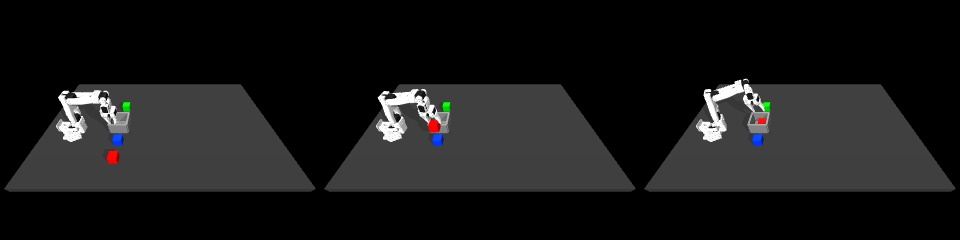

# From one human teleoperation to a visual training example

Your multicube lab recordings already contain personally collected robot demonstrations. We confirmed **42 teleoperation episodes and seven DAgger correction segments**. This stage converts one complete training episode into reconstructed camera images, robot inputs, action labels and an instruction. It does not train a VLA or merge datasets.

[Full reconstructed episode video](assets/human-visual-episode.mp4) · [Measured report](human-visual-episode.json) · [Human/phone action differences](data-compatibility.md)



These frames are reconstructed from recorded robot joints, all three cube poses and the bin position. No original camera frames were stored. The converter uses `mj_forward` to compute the visible geometry; it does not advance physics or execute actions. The video is a pose reconstruction, not a new success evaluation.

## The dataset we found

| Source | Episodes or correction segments | Red / green / blue | Available transitions |
|---|---:|---|---:|
| Human teleoperation | 42 | 11 / 15 / 16 | 10,400 |
| DAgger human corrections | 7 | 2 / 3 / 2 | 1,201 |

The raw teleoperation sessions have 10,442 observations; the corrections have 1,208. Each complete stored segment contributes one fewer transition than observations. The empty teleoperation session contributes none. Processed stores are derived copies of these recordings, not additional independent demonstrations. DAgger segments are retained separately; the converter currently handles only the original 42 episodes.

Raw data is read from the external lab checkout. The source-store list in the original processed dataset defines global episode order, so arbitrary filesystem discovery cannot silently renumber the episodes. Existing zero-based validation IDs **36, 9 and 32** remain validation; all other original episodes retain their training assignment. This stage converts only global episode **0**, a red training demonstration. No new test split is invented, and the phone source-family split is unchanged.

## What the converter produces

`scripts/convert_human_episode.py` has two parts. `read_episode` selects the original raw rows, checks shapes and constant colour/bin labels, and verifies the action labels against the processed lab store. `main` reconstructs every image, saves aligned arrays and creates a preview and report. Original Zarr stores are opened read-only.

For each step, the candidate model inputs are:

- The reconstructed RGB image, 320 × 240 pixels, from the original `angle` camera.
- The instruction: **“Put the red cube in the bin.”**
- Nine measured robot values: six joint angles, including the jaw, and three hand coordinates.

The action label has four values: measured hand displacement in XYZ over the next recorded interval, followed by the native gripper command recorded at the current step. Thus `image/state[t]` pairs with `action[t]` and has a following `image/state[t+1]`. The final observation is retained but has no following action.

The output also retains raw cube/bin/colour and robot-pose arrays for diagnostics and provenance. Cube/bin coordinates and the one-hot colour label are not part of the nine-value robot input. The instruction is derived from the recorded colour label. No current action command is inserted into the robot input.

This differs deliberately from the earlier phone-generated 13-value input: the human recording does not contain original hand-target commands. We do not invent three target coordinates to make dimensions match. The earlier phone interface test and its loader remain unchanged. `human_visual_v1` is an intermediate NPZ format, not yet a LeRobot dataset or an accepted training corpus.

## Measured conversion

| Check | Result |
|---|---|
| Original global episode / assignment | 0 / training |
| Observations and reconstructed images | 339 |
| Action labels | 338 |
| Nominal sequence duration | 33.8 seconds |
| Robot input / action dimensions | 9 / 4 |
| Preview video | 339 frames at 10 Hz |
| Actions versus original processed lab labels | Exact match |
| Largest measured XYZ displacement | 9.642 mm per interval |
| Maximum reconstructed hand-position difference | 0.0572 mm |
| Normalization fitted / VLA trained | No / no |
| Accepted into training | No |

The project environment uses MuJoCo 3.14.0. The prior three-frame inspection in the lab's MuJoCo 3.15.0 environment had smaller hand-position differences. The full conversion above reports its own measured version and error, rather than assuming bitwise equivalence across simulator versions. Source collection metadata does not identify the original MuJoCo version.

We verified image/state/action dimensions, terminal observation retention, finite numerical inputs, nominal timestamp spacing, video length, source and output checksums, and exact action alignment. Invalid episode IDs are rejected. Re-reading every array and episode boundary from the previous audit confirmed that all **49 original episodes/segments remain unchanged**. The frozen 1,418 baseline artifacts also verify unchanged.

## Run this stage

Use the project [isolated VLA environment](vla-setup.md), including the newly declared `zarr==3.4.0` dependency. The existing lab environment is not changed. The external lab checkout must contain its original simulator assets and original raw/processed multicube stores; these human artifacts are not part of the existing public baseline archive.

```bash
MUJOCO_GL=egl .venv-vla/bin/python scripts/convert_human_episode.py \
  --lab /path/to/so101-behavior-cloning \
  --episode 0 \
  --out work/my-human-visual-episode
```

Use a new output directory. Expect `339` observations, `338` actions and the red instruction in the printed report. Outputs are `episode.npz`, `episode.avi`, `preview.jpg` and `summary.json`. The measured run is retained locally in `work/human-visual-episode-20261015-01`, with a verification report and exact converter snapshot. Larger output files stay outside Git; the linked preview media and small measured report are included.

The path passed to `--lab` is explicit configuration. No personal filesystem path is embedded in the converter. The original processed store's source list and exact 42-episode count are checked, rather than silently accepting an altered dataset with different split numbering.

## What remains before training

The [source-aware human interface check](vla-human-batch.md) now passes for a normal batch and the final-action boundary, using temporary training-only statistics and no saved changed weights. Before adopting the corpus, check whether a declared controller can reproduce useful movement from the achieved-position action labels under physics. Reconstructed images do not establish this: original mocap position/orientation targets and velocities are missing. Four-value actions also do not represent intentional wrist rotation; the recorded orientations remain available for a later interface decision.

Timestamps are inferred from the nominal 10 Hz setting; original wall-clock timestamps were not stored. The original wide camera makes cubes small, so framing still needs review before corpus conversion. Contact forces, penetration and placement quality are not certified by this pose reconstruction. The existing phone contact-quality checks are not bypassed or assigned fabricated pass flags.

Once the interface and execution checks are satisfactory, freeze accepted training/validation IDs and fit normalization using training transitions only. Review the seven DAgger segments and their layout/source provenance separately before assigning or combining them. Do not concatenate human achieved-motion labels with the phone controller's target-motion labels without defining and checking a common action convention.

Presentation explanation: “I recorded the robot by teleoperation. Because I saved robot and object poses, I can reconstruct synchronized simulator images and pair them with my actions and colour instruction. That creates candidate examples for fine-tuning a VLA; training and closed-loop evaluation are separate steps.”

The [first action replay under physics](human-physics-replay.md) has now been recorded: one red transfer completed, but maximum target penetration was 5.05 mm and the quality screen failed. The original candidate remains excluded from training. Diagnose the contact before adopting a corpus; the reconstructed-pose video and model-batch checks are separate evidence.
