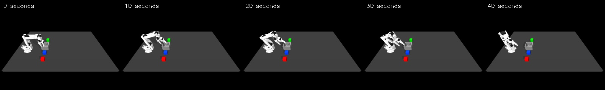

# More VLA training: lower loss, still no pickup

Increasing training from 200 to **2,000 updates** reduced fixed-window validation loss from **1.9726 to 1.2959**. The same development rollout still failed to pick up the red cube. This tests one training start, not held-out success rates.



[Watch the rollout](assets/human-vla-2000-rollout.mp4) · [Reports and verification](human-vla-2000-updates.json) · [Original training setup](human-vla-training.md) · [First rollout](human-vla-rollout.md)

## What changed?

Only the training limit changed: 2,000 batches instead of 200. The run started from the same pinned pretrained model and adapter initialization, with seed 42, learning rate 1e-4, batch size one and rank-four LoRA. It did not resume the old adapter. The first 200 logged sample/loss records match the pilot exactly.

All 2,000 starting windows are distinct, span all 39 training episodes, and exclude validation IDs 9, 32 and 36. The dataset, normalization, fixed loss probes and training source are unchanged. This is still a partial epoch over 9,616 available training starts, and overlapping action chunks are not independent demonstrations. Phone examples, DAgger segments and scripted corrections remain excluded.

## Measured comparison

| Measurement | 200 updates | 2,000 updates |
|---|---:|---:|
| Fixed training loss, 24 windows | 1.7006 | 1.0724 |
| Fixed validation loss, 24 windows | 1.9726 | 1.2959 |
| Pickup / placement on episode 0 | Failed / failed | Failed / failed |
| Closest hand–red-cube distance | 16.6 cm | 18.1 cm |
| Peak cube-centre height | 2.0 cm | 2.0 cm |
| Final hand-to-commanded-target error | 16.7 cm | 8.8 cm |
| Movement / gripper clipping events | 0 / 11 | 8 / 1 |

Both rollouts use the same initial poses and image, instruction, seed, simulator/scene, 400 control steps, 10 Hz control, 500 Hz physics, four-command execution horizon, 12 mm movement limit, fixed initial hand orientation and native instant gripper targets. The only evaluator source change makes the report's update-count text accurate; its control logic is unchanged. Neither rollout uses a scripted grasp or world-model assistance.

The new video shows the arm moving away from the red cube without picking it up. It finishes with a smaller target-tracking error than the pilot, but does not approach the cube more closely. Both pass the depth/distractor checks because they barely interact with objects; this is not successful manipulation. The new mean prediction time was 185 ms on the RTX 4060 Laptop GPU; physics pauses during inference. Peak PyTorch training allocation remained 1,293.4 MiB.

## Reproduce

With the prepared corpus and VLA environment, run from the project root using new output directories:

```bash
.venv-vla/bin/python scripts/train_vla.py \
  --dataset work/human-vla-dataset-20261015-01 \
  --epochs 1 --max-train-batches 2000 \
  --out work/my-human-vla-2000

.venv-vla/bin/python scripts/evaluate_vla.py \
  --lab /path/to/so101-behavior-cloning \
  --dataset work/human-vla-dataset-20261015-01 \
  --checkpoint work/my-human-vla-2000 \
  --episode 0 --seed 42 --max-steps 400 --execution-horizon 4 \
  --out work/my-human-vla-2000-rollout
```

The saved local run uses `work/human-vla-2000-updates-01` and `work/human-vla-2000-rollout-01`. The latter used cached pinned model files with `HF_HUB_OFFLINE=1 TRANSFORMERS_OFFLINE=1`. Source snapshots, sample logs and verification remain with these outputs. The existing evaluator verifies exact adapter restoration before acting. All 1,418 historical artifact checksums still pass. Public packaging of the human corpus and adapters remains pending, and the external simulator dependency must be obtained separately.

## What this tells us

More training improved the offline learning measurement, but 2,000 updates did not solve this development case. It does not establish that further training cannot work. Before a substantially longer run, compare predicted actions against human labels at recorded approach/grasp states, and inspect how accumulated targets depart from the measured hand during execution. This can distinguish inaccurate action predictions from an execution mismatch more directly than loss alone. The current labels are achieved hand displacements, not the missing original target commands.

Presentation explanation: “I changed only the training duration and repeated the same robot test. The learning loss improved, but the robot still missed the cube. I kept both outcomes so the next change can address the control failure rather than just optimize the training score.”
