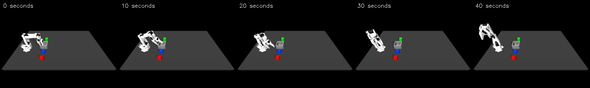

# First VLA rollout: the arm moves, but misses the cube

The saved human-only SmolVLA adapter ran in the simulator for **400 control steps (40 simulated seconds)**. It did not grasp or move the red cube. This is one development run starting from **training episode 0**, not a held-out success-rate benchmark.



[Watch the full rollout](assets/human-vla-rollout.mp4) · [Measured report](human-vla-rollout.json) · [Training experiment](human-vla-training.md) · [Evaluation code](../scripts/evaluate_vla.py)

## What controls the robot?

Only the first recorded pose initializes the scene. After that, the simulator supplies a live RGB image and nine measured robot values. These, together with “Put the red cube in the bin.”, go into the saved VLA. It predicts 50 actions; the executor applies the first four and observes again. No later demonstration states or actions are replayed. No scripted grasp, placement helper or world-model selector takes over.

The four action values are XYZ hand displacements and the native gripper command. Displacements accumulate into the hand target, with a 12 mm norm limit per control step. The initial hand orientation stays fixed. The gripper uses instant targets and the simulator's unchanged +/-3.5 Nm motor limit. Physics runs at 500 Hz and control at 10 Hz; physics pauses during model inference.

## What happened?

| Measurement | Result |
|---|---:|
| Task completion | Failed: no pickup |
| Executed steps / predictions | 400 / 100 |
| Closest measured hand–target-cube distance | 16.6 cm |
| Peak cube-centre height | 2.0 cm, its resting height |
| Mean / maximum prediction time | 202 / 479 ms |
| Movement / gripper clipping events | 0 / 11 |
| Final hand-to-commanded-target tracking error | 16.7 cm |

The arm drifts upward and away from the red cube. Its commanded hand target eventually gets ahead of the physical hand. Passing the penetration and distractor-motion checks does **not** mean success: the robot barely interacts with the objects. Peak target contact force was approximately 0.123 N, consistent with the resting cube rather than a successful grasp. No numerical warning or out-of-bounds termination occurred.

The rollout starts with exactly the same RGB image and cube poses as the converted training episode. Its initial robot state differs by less than 2e-8. The log contains 401 observations, 400 commands, 100 predicted chunks and 20,000 physics samples. Checks confirm replanning every four commands, execution of the first four predictions, and exact target accumulation within floating-point tolerance. All 1,418 historical artifact checksums still pass.

These checks rule out the simple starting-image and command-order mistakes tested here. They do not prove that achieved-motion labels are ideal commands, that the model has learned colour selection, or that more training will necessarily solve the task. The adapter received only 200 updates. Its lower validation loss was an offline learning measurement, not a manipulation score.

## Run the same development case

From the project root, with the prepared human dataset, trained pilot adapter, isolated VLA environment and external lab simulator available:

```bash
.venv-vla/bin/python scripts/evaluate_vla.py \
  --lab /path/to/so101-behavior-cloning \
  --dataset work/human-vla-dataset-20261015-01 \
  --checkpoint work/human-vla-pilot-20261015-01 \
  --episode 0 --seed 42 --max-steps 400 --execution-horizon 4 \
  --out work/my-first-vla-rollout
```

Choose a new output directory. Expect progress every 40 steps and a final JSON summary. The saved run reports `task_success: false`, `quality_pass: true`, and `termination: "step_limit"`. Output files are `rollout.avi`, `rollout.npz`, `physics.npz`, and `summary.json`. Predictions can differ across GPU/software versions; report differences rather than replacing the original result. The measured run used cached model files with `HF_HUB_OFFLINE=1 TRANSFORMERS_OFFLINE=1` and `MUJOCO_GL=egl`.

Read the script in this order: `load_trained_policy` restores and verifies weights; `make_observation` builds inputs; `predict_actions` converts predictions back to physical units; `run_rollout` applies commands and records outcomes; `main` selects the training start and saves provenance. Development starts are restricted to the existing training IDs. This script does not implement the future held-out benchmark.

The dataset, adapter and full logs remain local artifacts; their public download package is pending. This command currently requires the separately obtained lab dependency. The tracked report and video are small reviewable outputs, not a claim that a fresh clone already includes all VLA prerequisites.

## Next experiment

Keep this failed pilot as evidence. A predeclared longer training run on the same 39 training episodes is a reasonable next step, followed by the same development rollout and unchanged validation probes. Do not adjust the held-out split or add scripted control to make this result appear successful. If training improves offline predictions but control still fails, investigate action semantics and accumulated target drift before expanding evaluation.

This human-only VLA contains no phone data or DAgger segments. The completed phone-derived BC/world-model experiment remains separate. Its single-cube 99/100 result is not directly comparable with this multicube development case; the proposed common benchmark also uses a different closing-rate profile.

Presentation explanation: “I trained a small adapter on my human demonstrations, then let its predictions control the simulated robot. The first short training run reduced learning loss but did not pick up the cube. I kept that failure and its video, so the next experiment can test whether additional training actually improves control.”
