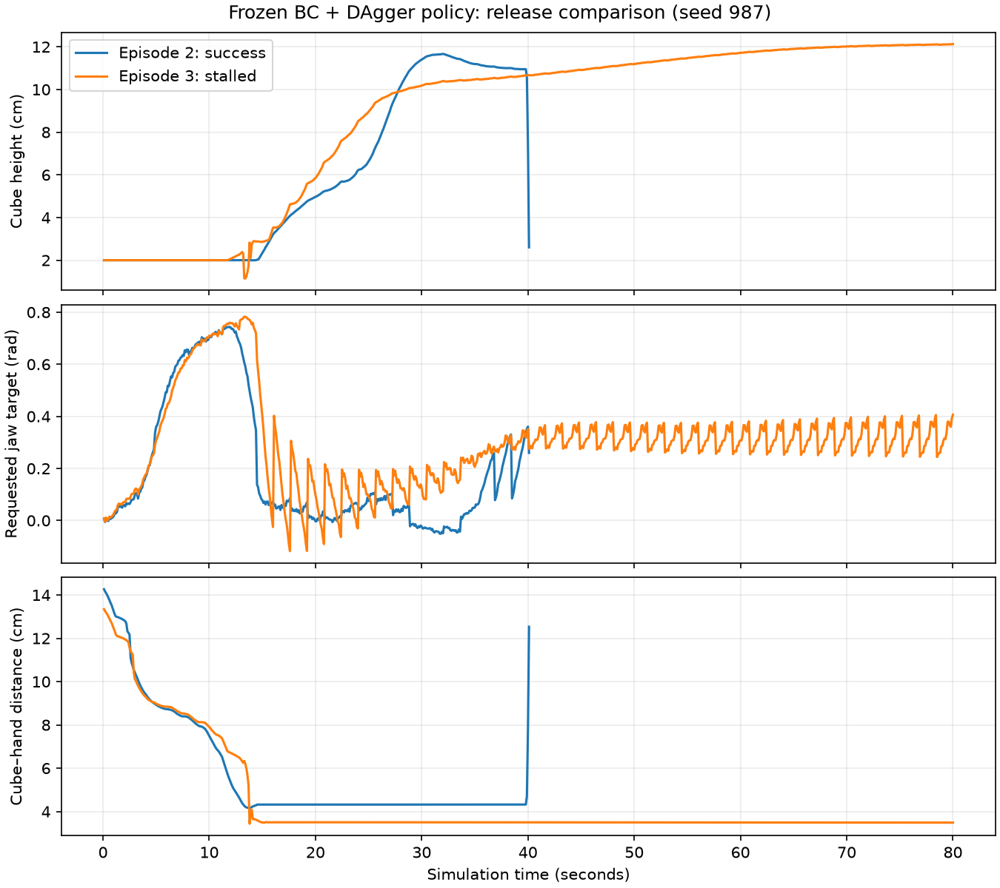

# Why the 82% policy fails

> Historical commands: some plotting, diagnostic and older evaluation scripts in this report were removed during cleanup. Use [the current walkthrough](walkthrough.md) for runnable simulation commands. The original scripts remain in Git commit `e686ed4`. Saved measurements and figures below are unchanged.

The frozen width-256, epoch-10 BC + DAgger checkpoint was replayed for all 100 shifted-obstacle episodes using seed 987, CPU inference, execution horizon 16 and an 800-step limit. Every episode's success/failure matches the earlier confirmation log: 82 successes and 18 failures. This is a diagnostic replay of an inspected evaluation set, not new generalization evidence.

| Observed failure outcome | Count | Episodes |
|---|---:|---|
| Ends elevated near bin | 10 | 3, 19, 21, 22, 35, 36, 37, 47, 54, 63 |
| No sampled lift above 45 mm | 7 | 13, 27, 30, 43, 67, 73, 86 |
| Lift then ends on table short of bin | 1 | 96 |

Labels use explicit thresholds: near-bin means final XY within 50 mm of bin center on each axis and cube z above 60 mm; no sustained lift means maximum sampled cube z below 45 mm. These labels describe outcomes, not proven causes or a contact-based grasp detector. Episode 96 reached 92.5 mm height, then ended at 20 mm height, about 124 mm short of the bin in Y.

## Successful versus stalled release



Episode 2 succeeds at step 401. The cube separates from the hand and falls into the bin. Episode 3 times out at step 800, with cube height 121.3 mm and approximately constant cube–hand distance late in the episode. Both carried the cube near the bin.

The successful run's last 80 requested gripper targets range from -0.046 to 0.360 rad, whereas failed episode 3's last 80 range from 0.244 to 0.406 rad. A larger requested opening alone does not explain release success across these two examples. Actual hand motion, grasp geometry, actuator tracking and training coverage remain possible factors. The plot does not establish which is causal.

Obstacle contacts were present in successful episode 2 as well as failed episode 3. Contacts are logged only at control-step endpoints, so short intervening contacts may be missed. No force or collision explanation is established by these counts.

## Next improvement experiment

Start with human corrections for completing placement/release, because it is the largest observed failure group. Aim initially for five successful takeover segments from new training layouts, starting before the stall and continuing through release, hand retreat and cube settling. Keep them in a new collection; preserve original demonstrations, validation episodes and checkpoint. Then add grasp corrections if the seven no-lift outcomes persist.

Use a new correction-collection seed (20261016). Reserve seed 20261017 for the first comparison of the resulting candidate and frozen baseline, 100 episodes per distribution. Freeze that candidate before the new comparison; if those outcomes guide further tuning, treat the layouts as development data and use another untouched seed for final confirmation. The historical seed 987 remains useful for diagnosis, not a fresh test after this analysis.

Run the lab's existing human takeover interface from the lab root:

```bash
python scripts/dagger_eval.py \
  --checkpoint checkpoints/single_cube/epoch_comparison/epoch010_ee_xyz_obstacle_dagger24ep_width256.pt \
  --num-episodes 20 --max-steps 800 --seed 20261016 \
  --output-dir datasets/raw/single_cube/dagger/release_corrections_v1
```

This launches an interactive recording session; no human recordings were made by the diagnostic replay. Watch for a stalled placement, take over using the configured record key, complete placement and release, retreat, and let the cube settle. Keep only verified successful corrections and document excluded recordings. Do not merge or retrain until that collection has been reviewed.

The current phone-project world model uses a different scene profile and was tested mainly on artificial premature opening. It has not been trained or evaluated for this lab policy's stalled release. Compare targeted DAgger improvements first; then test model-assisted control on a concrete remaining failure.

## Reproduce the audit

From the phone project root:

```bash
python scripts/diagnose_lab_policy.py \
  --lab /absolute/path/to/so101-behavior-cloning \
  --checkpoint /absolute/path/to/so101-behavior-cloning/checkpoints/single_cube/epoch_comparison/epoch010_ee_xyz_obstacle_dagger24ep_width256.pt \
  --episodes 100 --out work/lab-failure-audit
python scripts/summarize_lab_failures.py \
  --run work/lab-failure-audit \
  --reference-log /absolute/path/to/so101-behavior-cloning/logs/confirmation_width256_seed987/adversarial.log \
  --out work/lab-failure-audit/failure-groups.json
python scripts/plot_release_comparison.py \
  --run work/lab-failure-audit --out work/lab-failure-audit/release-comparison.png
```

The source lab is an external dependency. Output folders and summary files must be new. The raw replay is saved locally under `work/lab-failure-audit-20261015`, with videos for episodes 2 and 3. Original policy weights and training data remain unchanged.
