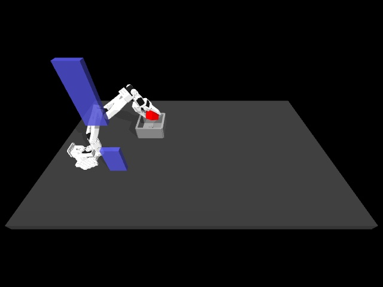

# First teleoperation-policy failure diagnosis

Replayed the first three shifted-obstacle episodes with the selected lab checkpoint, CPU inference, seed 987, 16-action execution horizon and 800-step limit. The sequence matches the saved confirmation log: success, success, failure. This diagnostic uses previously evaluated layouts and is not a new success-rate estimate.

| Episode | Result | Steps | Final cube height |
|---|---|---:|---:|
| 1 | Success | 417 | 27.5 mm |
| 2 | Success | 401 | 26.0 mm |
| 3 | Failure | 800 | 121.3 mm |

Episode 3 lifts and carries the cube near the bin but does not complete placement/release. The final saved frame shows the cube at the gripper above the bin. During the final 100 commands the cube moves within a range of approximately 1.0 mm in X, 3.7 mm in Y and 1.1 mm in Z. Requested gripper controls range from 0.244 to 0.406 during that interval. This supports diagnosing a stalled placement/release, without establishing why the policy stalls.

Obstacle contacts were observed at the end of 17 control steps in the failed episode and 14 in successful episode 2. Transient contacts between observations may be missed; contact counts alone do not establish the failure cause.

Next: compare the approach to release in successful episode 2 and failed episode 3, then inspect the remaining known failures before choosing targeted DAgger corrections. The current phone-project world model is trained on different scene settings and observations; transfer to this policy is not established.

Reproduce from the project root, substituting your local lab path:

```bash
python scripts/diagnose_lab_policy.py \
  --lab /absolute/path/to/so101-behavior-cloning \
  --checkpoint /absolute/path/to/so101-behavior-cloning/checkpoints/single_cube/epoch_comparison/epoch010_ee_xyz_obstacle_dagger24ep_width256.pt \
  --out work/lab-diagnosis
```

The output contains per-episode state/action arrays, end-of-step obstacle contact logs, summary metadata, and an episode-3 video sampled every five control steps. Original checkpoints and lab sources are unchanged.


