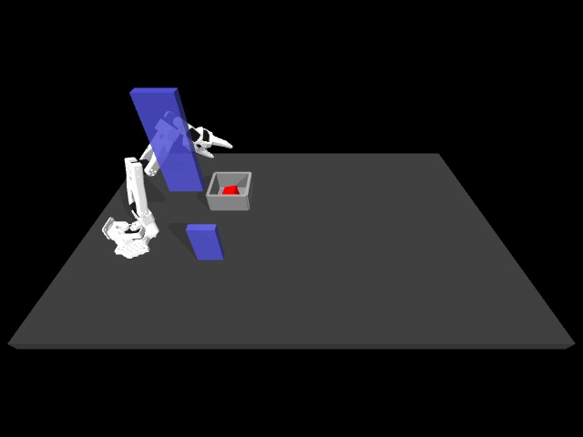

# Human approach plus phone transport: first integration pilot

## What was tested

This is demonstration generation under physics, not training or evaluation of a learned policy. The existing lab policy is unchanged. The experiment uses training data only: original human episode 1 and phone source IMG_5539. Both obstacles and the lab's original bin position are retained; randomization is disabled for this deterministic pilot.

The human approach is reconstructed from measured end-effector poses and recorded gripper targets, translated by the difference between the recorded and current cube starts. Commands execute through the simulator; the robot and cube are not teleported. The raw store does not contain original mocap commands, so this is an approximate command reconstruction, not exact replay of the original teleoperation.

The human prefix ends at sample 461: the recorded cube is lifted above 60 mm and carried beyond the obstacle by 80 mm in Y. The reconstructed execution reaches the same carrying region. The phone's progress and lateral curve then define transport from the observed handoff position toward the bin. Because the cube is already lifted, 25% of the phone's saved lift curve is retained. Hand orientation follows the human prefix and remains fixed thereafter. These are explicit retargeting choices, not measurements extracted from the phone video.

Placement uses a hand-written measured-state correction, followed by opening, retreat and settling. This combines sources within one generated demonstration; it does not yet demonstrate that a combined learned policy is better than either baseline.

## Development results

| Pilot, MuJoCo 3.14 | Obstacle contact | Task transfer | Cube-depth check |
|---|---|---|---|
| Original scripted approach, obstacles on | Yes | Fail: no lift | Pass |
| Original scripted approach, obstacles off | None | Fail: no placement | Pass |
| Human approach, low placement target | None | Fail: no placement | Pass |
| Human approach, above-bin release logic v1 | None | Fail: placement correction moved it away | Pass |
| Human approach, aligned above-bin release | None | Pass | **Fail: 4.29 mm** |

A separate original-approach test on MuJoCo 3.15 is also retained; it failed before lift with obstacle contact. It is not pooled with the 3.14 trials.

The final pilot completed 560 commands at 10 Hz. The cube reached 97.1 mm peak height and ended at (-0.1983, 0.6854, 0.0266) m inside the bin. The hand retreated and the cube passed the stability check. All obstacle contact counters were zero across 500 Hz physics samples. Maximum cube penetration occurred during the release phase, command 530, and exceeded the existing 2 mm quality threshold. This trial is explicitly **not accepted for training**.

Success after several revisions on this one training example is development progress, not a success-rate estimate or evidence of generalization. No world model or learned controller participates in these pilots. High contact loads remain an existing project limitation; this test logs contact depth, not force safety.



[Watch the final pilot](assets/phone-lab-pilot.mp4). It plays at real simulation speed. The video shows an adapted demonstration, not autonomous learned-policy performance.

## Run the test

Activate the documented environment with MuJoCo 3.14, then run from this project's root. The external lab checkout must contain its curated human Zarr dataset.

```bash
python scripts/test_phone_in_lab.py \
  --lab /absolute/path/to/so101-behavior-cloning \
  --approach human --source IMG_5539 --out work/human-phone-pilot
```

Use `--approach scripted` to test the older scripted approach under the current script. The release revisions in the historical failed runs are preserved as source snapshots alongside their outputs; the current script does not claim to recreate every earlier implementation. Use a new output folder for each run.

The output includes video, contact records, summary JSON, and T actions with T+1 states. `commands` are mocap-target increments, whereas `actions` use measured hand-position differences, matching the human lab preprocessing convention. Both retain the requested native gripper target. Original datasets, splits, checkpoints and results are preserved.

[Measured results and hashes](phone-lab-pilot-results.json) include every trial. Raw outputs and exact generator snapshots are retained in `work/phone-lab-pilot-20261015` and `work/phone-lab-hybrid-20261015`.

## Next check

Improve the generated release's contact behavior without relaxing the 2 mm threshold, then test additional training-source paths. Keep failed examples as diagnostic evidence. Only reviewed task-and-quality passes may enter a new dataset version. The original 97%/82% lab policy remains frozen; no further DAgger collection is planned.
