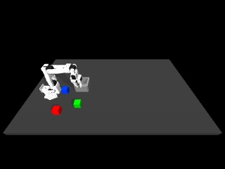
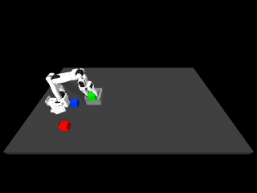
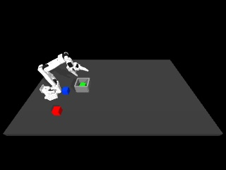

# First synchronized visual episode

This is a recording-pipeline check, not a VLA rollout or a policy-performance result. The existing successful `IMG_5539` phone-derived training demonstration supplies the commands. The robot carries the green cube into the bin, but the new recording fails the contact-depth check and is excluded from training.





[Watch the complete recording](assets/visual-episode.mp4) · [Measurements and provenance](visual-episode.json)

## What was recorded

The recorder uses the course multicube scene with MuJoCo 3.14.0. It places the green target cube and bin at the original demonstration locations, with the red and blue distractors to the side. The layout is fixed and is not a shuffled-position evaluation. The target choice is supplied to the replay program; no model interprets language in this recording.

The instruction is **“Put the green cube in the bin.”** The original phone footage supplies the transport shape. Approach, grasp, placement, release and retreat came from the existing scripted demonstration generator. This is not human teleoperation and not a new autonomous-policy success.

| Field | Recorded shape / meaning |
|---|---|
| `images` | 150 RGB frames, 240 × 320 × 3, uint8; camera `angle` |
| `robot_state` | 150 × 13; six joint angles, hand XYZ, commanded target XYZ, applied gripper command |
| `actions` | 149 × 4; world-frame target XYZ deltas per control step, requested native gripper target |
| `time_s` | 150 simulation timestamps, 0.1 seconds apart |
| `phase` | 149 original action-phase labels |
| `instruction` | One instruction applying to the whole episode |
| `qpos`, `qvel`, `cubes` | Simulation diagnostics, not VLA inputs |
| `mocap_target` | Recorded command position used to check action alignment |

An image and robot state are captured without stepping physics. `observation[t]` precedes `action[t]`; that action produces `observation[t+1]`. The final observation has no following action. The video contains the same 150 observations at 10 fps; the 149 control steps span 14.9 seconds. Target-position differences match the saved action deltas exactly. Commands also agree with the original demonstration within 1e-6.

This 13-state/4-action interface differs from the six-state/six-action synthetic SmolVLA memory test. It will need explicit model features and training-only normalization before real-data fine-tuning. The target cube position, goal one-hot label and bin coordinates are not included in the proposed VLA input. The current wide camera makes the cubes small; camera framing should also be reviewed before dataset expansion.

## Result and limitation

| Check | Result |
|---|---|
| Task completion | Yes: target lifted, settled in bin, gripper open, hand retreated |
| Peak target height | 0.103874 m |
| Maximum target penetration, measured at physics steps | **3.690 mm; fails the 2 mm quality limit** |
| Maximum distractor displacement | 1.028 mm |
| Accepted for training | **No** |

Recomputing contacts at the saved observation states found a 3.388 mm overlap with `bin_floor` at observation 113, after a `gentle_place` action. The every-physics-step peak is higher than this sampled observation value. This identifies a placement contact problem; it does not establish the cause of every contact peak. The multicube bin is smaller than the original single-cube bin, but that difference alone has not been shown to cause the floor overlap.

A saved command sequence is open-loop: it cannot adapt its placement to deviations in the new scene. The next step is to inspect and correct the placement behavior while preserving the recorded phone transport and labelling any new scripted adjustment. The 2 mm threshold stays unchanged. Gripper contact forces remain unvalidated; a contact-depth pass would not by itself prove physically realistic gripping.

The candidate remains in `work/visual-episode-20261015-01`, outside all frozen baseline datasets. Its family remains `IMG_5539`, assigned to training. Validation and test recordings were not used, and no normalization was fitted. No original dataset, checkpoint, or result was overwritten.

## Reproduce the candidate

Install the separate VLA environment using [the setup instructions](vla-setup.md). Download the baseline artifacts and obtain the external HW3 simulator as described in the main reproduction guide. From the repository root:

```bash
export ROBOT_LEARNING_HW3=/path/to/hw3_imitation_learning
MUJOCO_GL=egl .venv-vla/bin/python scripts/record_visual_episode.py \
  --source IMG_5539 --color green --out work/my-first-visual-episode
```

Choose a new output folder. Expected output is `episode.npz`, `episode.avi`, `summary.json`, and first/last frame images. The measured run reports 149 actions, 150 observations, `task_success: true`, `quality_pass: false`, and `accepted_for_training: false`. Physics and rendering can vary by version/platform, so inspect your own measurements.

The recorder refuses unsuccessful or held-out source demonstrations, verifies the raw-video and transport-path checksums, and protects existing output directories. `--color` changes which coloured cube is placed at the demonstration target location. That option alone does not provide layout diversity or balanced language grounding; those require a separate reviewed collection protocol.

## Placement follow-up

[The subsequent placement investigation](visual-placement.md) inspected every physics step and identified `bin_wall2` as the original largest contact, before the observed floor overlap. A separately labelled scripted teacher with an earlier handoff passed the unchanged depth check on this same training case. The original failed recording and measurements above are preserved.
