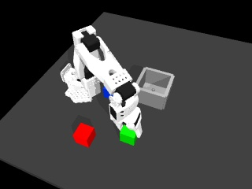
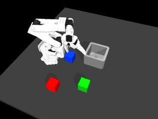

# First balanced visual-data collection pilot

We recorded the full planned matrix: six colour arrangements, each with red, green and blue target instructions. **12 of 18 attempts completed the task.** The six failures all came from the third pickup slot. No candidate was added to training, and this is not a VLA policy score.

[Complete manifest and failure audit](visual-pilot.json) · [Collection specification](visual-collection-plan.md) · [BC + WM versus VLA comparison protocol](controller-comparison.md)

## What was implemented

`collect_visual_pilot.py` declares all 18 attempts before execution and calls `record_visual_episode.py` in a fresh process for each. It saves logs, per-episode arrays/videos, source and script fingerprints, and a manifest updated after every attempt. Existing output directories are protected; there are no automatic retries. Failed recordings and failed tasks remain in the manifest.

The recorder's new `--slot-colors` option assigns all three physical cube poses independently of the requested target. Across the three instructions for each arrangement, initial RGB images, robot inputs, full qpos and camera settings matched **exactly** in the measured pilot. All six initial-scene checks passed. Changing the instruction therefore does not secretly move the target into one common pickup position.

Approach, lower and grasp targets are reconstructed from the original robot-specific offsets. The selected phone recording's processed progress, lateral motion and height are retargeted to the chosen cube and bin. The measured-derived transport is followed by the existing scripted placement teacher. These are simulated demonstrations generated with a teacher, not human teleoperation and not actions chosen by SmolVLA.

Retargeting a longer displacement can increase command size. The planner inserts linearly interpolated commands whenever a segment would exceed 12 mm. This changes timing nonuniformly and is recorded in provenance: the slot-0 full planned transport is 6.7 seconds versus the processed 6.5-second curve; slots 1 and 2 retain a 6.5-second plan. The actual successful recordings hand over to feedback placement before the curve ends. Retained counts and the replaced tail are reported separately. Original source files are unchanged.

## Fixed pilot outcomes

All episodes use only the `IMG_5539` training family, a fixed bin at approximately [-0.23, 0.57] XY, the fixed workspace camera, unchanged gripper/contact settings, and one target instruction per attempt. Colours are permuted across slots; this is not yet a broader shuffled-position dataset.

| Pickup slot | XY position, metres | Attempts | Task completions |
|---|---|---:|---:|
| 0 | [-0.35, 0.35] | 6 | 6 |
| 1 | [-0.23, 0.40] | 6 | 6 |
| 2 | [-0.35, 0.52] | 6 | **0** |
| Total | | **18** | **12** |

Each target colour succeeds in 4 of its 6 attempts. This does not measure language understanding: no learned model selected the target or generated these actions. The teacher is given the requested cube's simulator identity.

| Collection check | Count |
|---|---:|
| Episodes recorded without process errors | 18/18 |
| Task completed | 12/18 |
| Target-cube depth and distractor-motion checks | 18/18 |
| Camera projection-bound checks | 18/18 |
| Initial-scene consistency groups | 6/6 |
| Preliminary candidates eligible for review | 12/18 |
| Accepted for training | **0** |

A target-contact pass is not a successful task or a full physics-validity certificate. It checks target penetration <=2 mm and distractor movement <10 mm; it does not check every robot self-contact. Camera bounds do not rule out occlusion. The accepted subset would have no successful examples for slot 2, so training on the twelve candidates now would leave a clear task-coverage gap.

## The failed grasp

[Slot 0: red transfer completed](assets/pilot-slot-0.mp4) · [Slot 1: green transfer completed](assets/pilot-slot-1.mp4) · [Slot 2: blue pickup failed](assets/pilot-slot-2.mp4)

Successful grasp at slot 1:



Failed grasp at slot 2:



All six failing cases have approximately 35.24 mm hand-to-command error at the end-of-grasp observation. The jaw remains at about 0.991 rad despite an applied closing target of -0.174 rad. Peak cube height is only 0.02126 m, so the cube never achieves a lift. The placement helper eventually returns unsuccessfully.

Recomputing contacts at that saved pose for `arrangement_00_blue` found approximately **10.123 mm of self-contact penetration between `Rotation_Pitch` and `Fixed_Jaw`**, plus other arm/gripper contacts. This is a sampled-pose diagnostic, not an every-physics-step peak. It supports a collision/tracking problem with this fixed grasp setup; it does not prove that no other pose could reach the location. Increasing grip force is not an established remedy.

The next step is to correct the third-slot pickup setup or define and declare a reachable layout for this four-action controller, then run a new versioned pilot. If changing gripper orientation is required, it must be represented in the action interface or disclosed as a deployed helper; do not add an unrecorded orientation command that the VLA could never reproduce. Preserve this original 12/18 result rather than overwrite it.

## Validation and boundaries

All eighteen episodes passed timing, phase-length, command-delta and source-label checks. All target movement commands were <=12 mm. The original non-retargeted recorder mode was also rerun: its recorded physical arrays and actions match the earlier workspace-view candidate exactly. No original dataset, split, checkpoint or historical outcome was changed.

The raw pilot is `work/visual-pilot-20261015-01`. A separate one-case retargeting preflight occurred before the bounded-command planner was finalized; it is retained under `work/visual-retarget-preflight-20261015-01` and is not included in the 18-attempt count. The pilot manifest freezes recorder/collector source hashes and retains exact source snapshots. No normalization was fitted on these pilot episodes, no validation/test recording was used, and no VLA training was performed.

## Reproduce

From the project root with the [VLA environment](vla-setup.md), baseline artifacts and external HW3 dependency available:

```bash
export ROBOT_LEARNING_HW3=/path/to/hw3_imitation_learning
.venv-vla/bin/python scripts/collect_visual_pilot.py \
  --source IMG_5539 --out work/my-first-visual-pilot
```

Use a new output folder. For this measured configuration, expect 18 recorded attempts, 12 task completions, 12 preliminary review candidates and zero training inclusions. Inspect your own results because versions/platforms can change contacts and rendering. Individual AVI videos, NPZ episodes, JSON reports and logs are preserved; the linked previews are H.264 conversions.

For one balanced case:

```bash
.venv-vla/bin/python scripts/record_visual_episode.py \
  --placement feedback --framing workspace \
  --slot-colors red green blue --color red \
  --out work/my-retargeted-red-candidate
```

`--slot-colors` lists colours in slot order. The recorder requires each colour exactly once and requires feedback placement plus the fixed workspace camera. Without `--slot-colors`, the original single-candidate behavior remains available.
