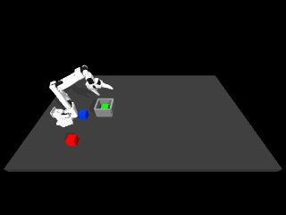

# Correcting the first visual episode's placement

The first synchronized recording reached the bin but failed the 2 mm contact-depth check. A scripted placement helper now passes that same check on the same fixed training layout: maximum target penetration is **0.971 mm**, and the green cube settles inside the bin. This is demonstration development, not a new learned policy or a VLA success-rate result.

[Watch the corrected episode](assets/visual-placement.mp4) · [All attempts and verification](visual-placement.json) · [Original failed recording](visual-episode.md)



## What was wrong

The original frame-level diagnostic identified floor overlap during placement. A finer replay inspecting every 2 ms physics step found that the largest overlap was actually with **`bin_wall2`**: 3.690 mm at approximately 11.18 seconds during `gentle_place`. The cube caught the rim and then fell onto the floor. The earlier floor measurement was real, but did not identify the largest contact.

The multicube bin is narrower than the original single-cube bin. Replaying the saved descent without adapting to cube position cannot reliably guide the cube past its rim. These observations explain this candidate's failure; they do not establish a general grasp or contact-force solution.

## The change

`record_visual_episode.py` now has `--placement replay` and `--placement feedback`. Replay is still the default and preserves the earlier behavior. Feedback is a hand-coded demonstration teacher, using simulator cube pose and geometry. It is not BC, MPC with a learned model, or a world-model decision.

The teacher takes over during phone transport when the cube is within 5 cm in XY of the bin centre and its lowest corner is more than 5 mm above the rim. If that condition is not reached, it falls back to the original placement-phase boundary. It then:

1. Maintains or raises the hand enough to clear the rim by a 15 mm bottom-clearance target, while moving the cube toward the bin centre.
2. Centres to within 2 mm in XY, with at most 2 mm correction per axis per control step.
3. Lowers in steps of at most 1 mm, continuing small horizontal corrections, until the cube bottom is within 3 mm of the floor.
4. Opens the gripper over 12 control steps while holding the hand target still.
5. Retreats by 14 cm over 20 steps and waits 15 steps for settling.

Centring is capped at 60 steps. Lowering is capped at 120 steps and stops unsuccessfully after 15 consecutive steps without at least 0.2 mm of new downward progress. These are scripted limits, not learned parameters. An unsuccessful helper remains a recorded candidate, not an accepted demonstration.

The source episode contains 65 approach/lower/grasp actions and 46 phone-transport actions. The passing candidate preserves the first **89 actions**, including the first **24 of 46 transport actions**. It replaces the remaining 22 transport actions and the old placement/release/retreat ending with the new teacher. All original source files remain unchanged. The resulting movement must be described as **phone-derived transport followed by scripted placement**, rather than a complete replay of the phone path.

## Measurements on this one training layout

| Development variant | Task completed | Maximum target penetration | 2 mm check |
|---|---|---:|---|
| Original saved-command replay | Yes | 3.690 mm | Fail |
| Feedback only after transport: lift vertically | Yes | 2.819 mm | Fail |
| Feedback only after transport: lift while centring | Yes | 2.806 mm | Fail |
| Earlier geometric handoff, then centre/lower/release | Yes | **0.971 mm** | **Pass** |

All variants use `IMG_5539`, the green target and the same fixed arrangement. They are development attempts on one case, not independent tests; the method was changed after observing the failures. No claim about held-out layouts or recordings follows from this table. Failed attempts remain saved locally and in the machine-readable report.

The passing candidate contains 251 actions and 252 aligned observations, spanning 25.1 seconds at 10 Hz. The original contained 149 actions over 14.9 seconds. The slower teacher prioritizes placement quality for demonstration collection; this is not a speed improvement. Its maximum distractor displacement is 1.028 mm. The quality condition remains maximum target penetration <=2 mm and distractor displacement <10 mm; it does not validate grip forces.

## Verification and remaining work

The original replay was rerun with the updated recorder. Its physical-state arrays, commands and 3.690 mm result match the first recording exactly. The corrected candidate's physical states and commands also match the original exactly through its 89-action prefix. Three RGB channel values differed by one intensity level between renders; image identity is not assumed across GPU renders.

The corrected recording passed time alignment, state/action dimensions, phase lengths and target-delta checks. All 1,418 historical artifacts still match their checksums. Training, validation and test family assignments remain unchanged. No validation/test recording was used in this development, no normalization was fitted, and no new VLA or BC checkpoint was trained.

The candidate still has `accepted_for_training: false`: it has not been added to a dataset or used for model training. It is a measured, inspected candidate for the next data-format stage. Simulator cube coordinates and geometry are teacher/diagnostic information, not proposed VLA inputs. The unresolved grip-force realism and wide camera framing still need attention before broader data collection or performance claims.

Next, check the real 13-state/4-action batch interface with SmolVLA, review camera framing, and define a balanced colour/layout collection protocol before expanding the visual dataset.

## Reproduce

From the project root with the [separate VLA environment](vla-setup.md), baseline artifacts and external HW3 dependency available:

```bash
export ROBOT_LEARNING_HW3=/path/to/hw3_imitation_learning
MUJOCO_GL=egl .venv-vla/bin/python scripts/record_visual_episode.py \
  --placement feedback --source IMG_5539 --color green \
  --out work/my-feedback-placement
```

Choose a fresh output directory. Expected measured configuration: `task_success: true`, `quality_pass: true`, approximately 0.000971 m maximum target penetration, 251 actions, 252 observations and 89 preserved source actions. Inspect your own results because physics and rendering can vary by version/platform.

For the original behavior, use `--placement replay`. Its expected candidate still fails the same quality threshold. The new helper changes neither scene geometry nor contact settings, and does not relax the acceptance limit.
