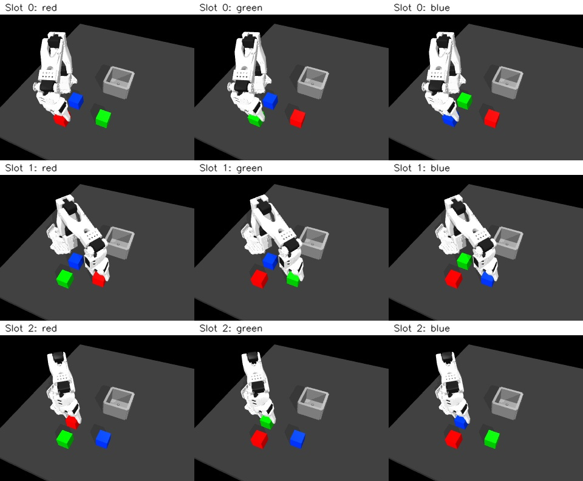

# A smaller workspace for visual demonstration collection

The second scripted collection pilot completed **18/18 transfers** after moving the third pickup slot 9 cm toward the front. This defines a smaller operating workspace for the current fixed-orientation controller. It does not solve the original failed position or measure a learned VLA policy.

[Measured manifest and diagnostics](visual-workspace.json) · [Original 12/18 pilot](visual-pilot.md) · [New third-slot transfer video](assets/front-pilot-slot-2.mp4)

## What changed and why

The original third slot was [-0.35, 0.52] metres in XY. At pickup, the fixed jaw collides with the arm and the hand misses its commanded position by about 35.24 mm. The original approach and three alternatives—via the front, via the outside, and from higher above—each failed to lift the cube. The alternative waypoints were [-0.375, 0.35, 0.16], [-0.45, 0.40, 0.16], and [-0.375, 0.52, 0.24] metres, followed by the original above-grasp target and descent. These are training-only diagnostics, not four policy evaluations. Each used unchanged orientation and force settings, followed by a 10 cm diagnostic lift.

Two separate workspace probes completed placement: moving the third cube to [-0.35, 0.43] or [-0.23, 0.48]. Both had no detected robot self-penetration. We selected the first for the new collection matrix: it retains 27 phone-transport actions versus 17 for the other candidate. Both probes remain recorded; they are not included in the 18-attempt count. The selected layout is a development choice using a training family, not an unseen evaluation layout.

The recorder and collector now expose `--layout original|front`. The default remains `original`. The front preset requires explicit balanced slot assignments; it cannot silently change the older single-candidate replay. Reports store the preset, actual coordinates, source hashes and maximum robot self-contact penetration, measured at every 0.002-second physics step. Review eligibility now additionally requires zero detected robot self-penetration. The existing target-cube quality check keeps its original meaning.

| Slot | Original XY, metres | Front preset XY, metres |
|---|---|---|
| 0 | [-0.35, 0.35] | [-0.35, 0.35] |
| 1 | [-0.23, 0.40] | [-0.23, 0.40] |
| 2 | [-0.35, 0.52] | **[-0.35, 0.43]** |

The bin stays at approximately [-0.23, 0.57]. Camera, hand orientation, 13-value robot input, four-value action format, gripper speed, torque limits and placement teacher are unchanged. Actions remain XYZ hand-target deltas plus a gripper command. There is no hidden wrist-rotation command.

## What the new pilot measured

The full six colour permutations × three target instructions were declared before collection, with no automatic retries. All 18 recordings derive from **one original training phone family, IMG_5539**. The teacher knows the target cube identity; no learned model is selecting the colour.

| Check | Result |
|---|---:|
| Recorded attempts | 18/18 |
| Task completions | 18/18 |
| Completions per pickup slot | 6/6 each |
| Completions per target colour | 6/6 each |
| Target penetration <=2 mm and distractor movement <10 mm | 18/18 |
| No detected robot self-penetration | 18/18 |
| Camera projection-bound checks | 18/18 |
| Initial-scene consistency across instructions | 6/6 groups |
| Eligible for further review | 18 |
| Accepted into a training dataset | **0** |

Maximum target penetration ranged from 0.971 to 1.106 mm. The largest movement command was 11.913 mm. The retained phone-transport counts are 31, 24 and 27 actions for slots 0, 1 and 2, respectively; feedback placement replaces the remaining transport tail. Approach, grasp, placement, release and retreat are scripted. These are generated simulated demonstrations, not human teleoperation or 18 independent phone recordings.

The original 12/18 pilot remains separate. Do not combine these layouts into one success score or present 18/18 as improvement on the unchanged original geometry.



These nine representative frames cover each slot and requested colour. They are simulator recordings, with labels added for presentation. The selected cube is between the jaws. The linked third-slot video shows the subsequent lift and placement.

## Reproduce this collection stage

From the project root, with the [isolated environment](vla-setup.md), baseline artifacts and external HW3 source available:

```bash
export ROBOT_LEARNING_HW3=/path/to/hw3_imitation_learning
MUJOCO_GL=egl .venv-vla/bin/python scripts/collect_visual_pilot.py \
  --source IMG_5539 --layout front --out work/my-front-visual-pilot
```

Use a new output directory. Expected measured counts are 18 recorded, 18 task completions, 18 preliminary review candidates and zero training inclusions. Inspect your own output: contacts and rendering can depend on versions. The measured run used MuJoCo 3.14.0. `--layout original` retains the earlier geometry and its known third-slot failure.

Each episode saves RGB images, robot inputs, actions, diagnostics, instruction, video and report. The collector saves all logs, checksums, a manifest and exact recorder/collector source snapshots. No normalization or task-trained VLA checkpoint is created.

## Verification and limits

We checked all new episode/report hashes, finite values, timestamps, observation/action alignment, input dimensions and training-source labels. Two default-layout regression runs reproduced the original successful green pickup and failed blue pickup: all physical arrays, actions and labels matched exactly. Images differed by at most one channel level in roughly 0.0004% or fewer channels, within the declared rendering tolerance. The 1,418 frozen baseline artifacts and all original pilot episode/report checksums remain unchanged.

Raw evidence is in `work/visual-front-pilot-20261015-01`, with development probes in `work/grasp-approach-diagnosis-20261015-01` and `work/grasp-workspace-diagnosis-20261015-01`, and regression runs in `work/visual-layout-regression-20261015-01`. These larger files are excluded from Git; the small measured report and preview media are included. The existing release archive does not yet contain this new collection.

This pilot uses three fixed slots, one fixed bin and one training phone family. Camera bounds cannot rule out occlusion, and the self-contact screen does not validate contact forces or all robot/environment interactions. The original difficult position still needs a different control setup or useful teleoperation evidence. No validation/test family was used or reassigned, and no VLA was trained or evaluated.

The next stage is to collect and inspect the same matrix for the other two training phone families, then freeze a versioned dataset with explicit family/layout splits. Normalization must use accepted training transitions only. Held-out visual data and closed-loop VLA evaluation remain separate work.

Presentation explanation: “My phone recording supplies the transport motion. A scripted robot teacher generates synchronized images and actions. The first collection exposed a self-collision, so I documented it and defined a smaller workspace before attempting VLA training.”
