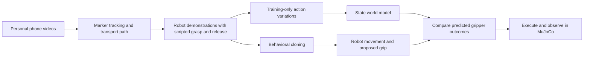

# Run and explain the project

Run commands from the repository root. Use a different output directory for each new evaluation: existing directories are deliberately protected.

## 1. Environment

Python 3.12 was used for verification. Create an environment, then install `requirements.txt`. On headless Linux set `MUJOCO_GL=egl`; a working EGL/OpenGL driver is required.

```bash
python3.12 -m venv .venv
source .venv/bin/activate
python -m pip install -r requirements-lock.txt
export ROBOT_LEARNING_HW3=/absolute/path/to/hw3_imitation_learning
export MUJOCO_GL=egl
python scripts/check_setup.py
python scripts/release_artifacts.py verify
```

The HW3 simulator is an external dependency. See `../THIRD_PARTY.md`. Its directory must contain `hw3/sim_env.py` and `so101_gym/assets/so100_transfer_cube_obstacle_ee.xml`. Install its additional requirements if your supplied version needs them. The saved dependency fingerprints document the exact local files used for verification; an upstream checkout may differ.

Download the versioned artifact archive from this project's GitHub Release when published. Extract it at the repository root, then run the checksum command above. Publication is pending; no download URL is claimed yet.

## 2. Saved BC rollout

```bash
python scripts/evaluate_model_control.py --mode bc --video --out work/first-bc
```

Open `work/first-bc/rollout.avi` and `result.json`. Expected on the verified environment: validation success in 131 steps, contact-depth pass, and zero gripper overrides. This is one validation example, not a new success-rate estimate.

Presentation explanation: “My recorded transport movements were converted into robot demonstrations. Behavioral cloning learns the mapping from the current measured state to the next movement and gripper actions.”

## 3. World-model control

```bash
python scripts/evaluate_model_control.py --mode wm --video --out work/first-wm
python scripts/evaluate_model_control.py --mode bc --stress-open --out work/bc-opening
python scripts/evaluate_model_control.py --mode wm --stress-open --out work/wm-opening
python scripts/compare_model_control.py --layouts 20 --seed 20261009 --out work/paired-comparison
```

The last command runs 80 episodes: two controllers, two conditions, twenty layouts. The seed reproduces previously inspected development layouts; it is not an untouched test set. Historical counts are 20/20 for both ordinary controllers, 9/20 for BC under the injected opening, and 20/20 for model-assisted control under that fault. Inspect new outcomes rather than assuming those counts.

Presentation explanation: “The world model predicts the consequences of alternative gripper commands. A task-specific score compares those predictions. This experiment tests one artificial premature-opening error; it does not establish general robustness or realistic grip forces.”

## 4. Training after understanding evaluation

```bash
python scripts/train_policy.py --data data/demonstrations_v2 --out work/retrained-bc
python scripts/train_world_model.py --data data/demonstrations_v2 --extra-transitions data/action_variations_v1 --out work/retrained-wm
```

These create new weights. Training may vary across software/hardware; compare held-out imitation metrics and new rollouts rather than expecting identical weight hashes. Preserve the existing checkpoints.

For extraction, `prepare_recordings.py` runs the four phone-processing scripts in order, using saved manual intervals. For regeneration use a new version:

```bash
python scripts/prepare_recordings.py
python scripts/generate_dataset.py --version reproduction --gripper-close-rate 1
```

## Presentation outline

1. Show one original phone clip and its extracted path.
2. Explain measured transport and scripted manipulation phases.
3. Show the autonomous BC rollout.
4. Show the opening-fault comparison and explain the learned predictions and hand-written score.
5. Report sample counts, the small number of independent phone recordings, calibration assumptions and high contact forces.


