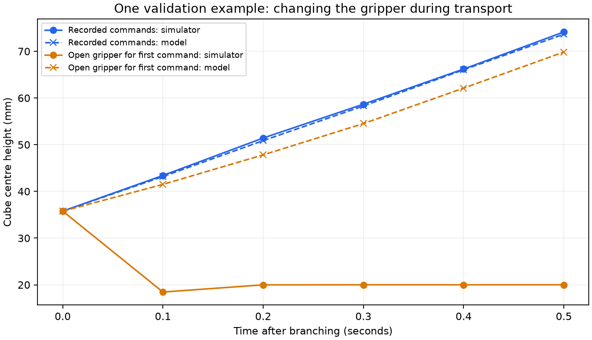

# Can the world model predict alternative actions?

The first model predicts recorded motions well, but this experiment finds weak
prediction of action changes. We have not enabled model-based control. The next
step is to add varied-action transitions from training families and retrain.

## Experiment

The frozen world_model_v1 checkpoint was tested at six moments in each of four
base demonstrations: start/end of grasp, early/middle transport, placement and
release. Three source videos belong to training and one to validation. IMG_5543
was not opened in this experiment. This is a development diagnostic, not a new
final held-out result.

At each moment we copied all MuJoCo simulation data, including the contact solver
state. Eight branches start from that identical snapshot:

- The recorded command sequence.
- A +2 mm or -2 mm change along each of x, y and z in the first command.
- A flipped first gripper request: open instead of close, or close instead of open.

The remaining four action increments and gripper requests are unchanged. Because
movement commands are increments, the 2 mm target shift persists over the window.
The gripper change lasts one requested command; its physical consequences can
last longer. The model receives its own predicted states after initialization.

This produces 192 branches: 144 training-family branches and 48 validation-family
branches, each with five transitions. These are correlated simulations from four
recordings, not 192 independent demonstrations. No weights were updated.

## Validation results

Cube error is mean absolute error across x, y and z, in millimetres.

| Action choice | Branches | Error after 0.1 s | Error after 0.5 s |
| --- | ---: | ---: | ---: |
| Recorded | 6 | 0.279 | 1.441 |
| Small position change | 36 | 0.501 | 1.683 |
| First gripper request flipped | 6 | 4.394 | 10.323 |

These six selected contact/transport moments differ from the all-timestep windows
in the original prediction evaluation, so their averages are not directly comparable.

An absolute error can look small even if the model misses the effect of an action.
We therefore also compare the change from the nominal outcome: predicted changed
outcome minus predicted nominal outcome, versus the same difference in MuJoCo.
A baseline predicts that changing the action has no effect.

| Action change, after 0.5 s | Model cube-effect error | Ignore-change baseline error |
| --- | ---: | ---: |
| Position | 0.933 mm | 0.474 mm |
| Gripper | 10.021 mm | 9.258 mm |

The model is worse than this simple baseline on both groups at 0.5 seconds.
For position changes at 0.1 seconds the difference is small: 0.414 mm for the
model versus 0.433 mm for the baseline. This is not enough evidence to trust it
to select better actions.

The largest gripper-flip cube error among the six validation anchors occurs in
early transport: 29.291 mm at 0.5 seconds. This example is shown below; it was
selected after examining errors and is not an average or a fresh test case.



## Interpretation and next step

The training demonstrations mostly show successful grasp/transport/release
sequences. They provide limited evidence about different actions from the same
state, such as opening during transport. Inadequate coverage is a plausible
explanation for these failures; this experiment does not isolate it from network
capacity or other modeling errors.

Next, collect more varied-action transitions from the three training source
families. Keep validation-family branches out of training. Train a separate
checkpoint and compare ordinary-motion prediction and alternative-action
prediction on the same development checks. Keep the test source out of tuning.
Only then evaluate short-horizon action selection around the BC policy, with a
fresh final evaluation to follow. Better prediction alone does not demonstrate
better robot control.

## Reproduce and inspect

With the existing homework environment active and ROBOT_LEARNING_HW3 set, run
from the project root:

```bash
python scripts/probe_world_model.py
```

For another run, pass a new `--out` directory. Existing output directories are
protected. `--data` and `--checkpoint` select the data and frozen model.

Results are in `results/world_model_v1_action_probes/`:

- `manifest.json`: fixed anchors, variants, execution profile and source/code hashes.
- `branches.npz`: actual and predicted states, actions, source, split and anchor.
- `metrics.json`: training/validation summaries and phase breakdowns.

State arrays have shape (24 anchors, 8 variants, 6 states, 35 features). Index zero
is the shared initial state. Repeating every nominal branch after restoring the
snapshot reproduced all saved states exactly at float32 precision. Replaying
the saved demonstrations deviated by at most 0.000015 mm in cube coordinates
and 0.000030 mm in hand coordinates at anchors. Saved metrics were independently
recomputed from branch arrays; source and checkpoint hashes matched afterward.

These checks establish reproducibility of this diagnostic. The model still does
not predict contact forces, and no new task-success result is claimed.
