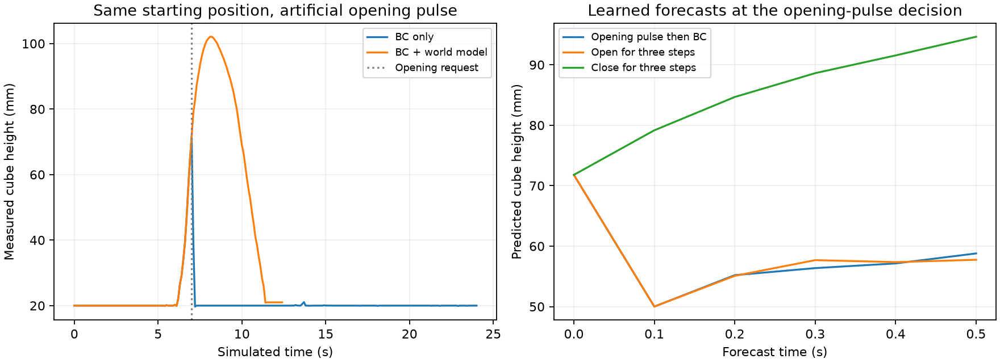

# World model used for gripper control

The learned state world model now runs inside the robot's control loop. BC v2
supplies movement and its usual gripper requests. The world model predicts three
gripper alternatives over 0.5 seconds and can replace the next request. It uses
learned predictions rather than simulator branching to choose that action.

Both neural checkpoints are unchanged. No additional training was performed.
This remains state-based control, not a VLA; there are no camera or language
inputs to either controller.

## Results

| Condition, 20 positions | BC tasks | BC tasks and depth passes | BC + world model tasks | BC + world model tasks and depth passes |
| --- | ---: | ---: | ---: | ---: |
| Ordinary execution | 20/20 | 20/20 | 20/20 | 20/20 |
| One artificial early opening request | 9/20 | 0/20 | 20/20 | 20/20 |

The revised selector rejected exactly one opening request in every stress trial.
It made no changes in ordinary trials. Every revised ordinary rollout exactly
matched its BC reference; every revised stress rollout exactly matched the
unperturbed BC reference, including actions, states and force traces.

Worst cube penetration was 1.696 mm for ordinary execution and protected stress
trials, versus 5.850 mm for BC under the injected error. The worst jaw normal-load
peak remained 1,057.5 N. This experiment does not reduce gripper force or establish
realistic contact physics. A depth pass means maximum penetration <= 2 mm only.

The median episode's 95th-percentile selector time was about 0.55 ms in the revised
stress runs on this CPU environment. This covers the selector call, including
its inactive checks; it is not total controller latency or a hardware benchmark.



Watch [the comparison video](../results/world_model_control_comparison.mp4).
It renders the saved simulator states for layout_02: BC drops the cube and fails
to transfer it, while the model-assisted controller rejects the pulse and finishes.
The right pane holds its last saved state after completion. This is a visual
replay of real simulation measurements, not a new live execution.

## How the selector works

At each 0.1-second control step it uses the remaining BC target predictions and
the current measured robot/cube state. Its five future movement commands apply
the same workspace bounds and 12 mm step limit as the actual executor.

It compares three gripper sequences:

1. The BC requests.
2. Opening for three commands, then resuming the BC requests.
3. Closing for three commands, then resuming the BC requests.

The frozen world_model_v2 predicts each sequence. During carrying, the reference
keeps the initial cube-hand offset relative to the nominal predicted hand motion.
During placement, the reference keeps the initial cube xy position at the bin
height plus the 20 mm cube half-size. The score is mean Euclidean cube-reference
distance across the five predicted states. An alternative must improve it by at
least 5 mm; otherwise BC is retained. Invalid nominal forecasts also fall back
to BC. Only the first selected gripper request is executed before measuring again.

These references, activation rules and margin are hand-coded design choices.
The physical transition predictions come from the learned model. Active carrying
requires cube height > 45 mm. Placement requires the cube within the bin's 40 mm
xy tolerance and below 35 mm. Approach and initial grasp stay with BC, so this
selector does not address the previously observed missed initial lift.

The revised selector also keeps BC when the low cube is in the bin and the
applied gripper command is already open. Movement still uses four BC commands
per observation; the model does not plan position commands. Its five-step look-ahead
assumes cached BC target predictions even across the next BC replan, which is
another reason to execute only one gripper request from each comparison.

## What was tested and what changed

The first protocol was saved before control evaluations. Both models, candidate
sequences, scoring rule and 5 mm margin were fixed. Twenty wider starting
positions were sampled with seed 20261009, x offsets [-40, 40] mm and y offsets
[-30, 40] mm. Both controllers used identical positions and execution settings:
10 Hz commands, 500 Hz physics, 1 rad/s closing and +/-3.5 N m jaw actuator torque.

The artificial fault requests opening for one command when the measured cube
first exceeds 70 mm, remains outside the bin region and both applied/BC gripper
commands are closed. Subsequent BC requests resume. All 20 stress trials triggered
this fault. It is an explicit intervention, not a naturally observed policy error.

Revision 1 passed all ordinary and protected stress tasks, but made 139 unnecessary
gripper changes across the ordinary trials. It predicted cube drift after release
and began closing the empty gripper. In validation, the actual cube moved only
0.103 mm over one inspected half-second, with zero jaw/cube load, while the nominal
forecast scored about 19 mm from its reference. This exposed a late-state model
limitation despite successful task outcomes.

Revision 2 adds the already-open placement check. It was assessed on the same
previously inspected positions: this is a development retest, not fresh final
evaluation. It preserves 20/20 stress protection and removes the unnecessary
ordinary interventions. The 40 BC results are explicitly reused from revision 1;
only the 40 revised model-assisted episodes were rerun. Both revisions, their
source snapshots and all successful/failed outcomes remain saved.

## Prediction evidence and limits

On the revised controller's visited states, one-step cube coordinate MAE for the
executed choice was 0.208 mm. At the pulse states, the alternative opening
prediction's one-step error was 3.177 mm, measured against BC's actual opening
branch from identical initial states. The model ranked opening as worse in all
20 cases; the smallest predicted score improvement for closing was 23.07 mm.
Correct action ranking does not imply accurate quantitative predictions of a drop.

Every tested pulse also satisfies a simple rule: reject opening while the cube
is elevated and outside the bin. That rule was checked on the decision states;
a live rule controller was not evaluated. These results therefore demonstrate
world-model integration and protection against this particular error, not that
the model is necessary or better than a simple guard.

Only cube starting position varies. There is one seed, one object, fixed mass and
friction, no obstacles and no camera or embodiment changes. No improved ordinary
task success, force control or broad robustness is established. Future work should
compare a live rule guard and less predictable disturbances, with a fresh protocol
and without using test recordings for tuning.

## Checks and saved files

Before model-based evaluation, the new runner's BC-only mode reproduced all saved
BC v2 validation states, actions and force/depth samples exactly. Revised runs
passed state/action alignment, 12 mm movement cap, 2 ms physics sample spacing,
500 Hz recording count and 3.5 N m torque-limit checks.

All 130 existing demonstration files, both BC checkpoints, both world models,
existing evaluation scripts and the 13 agent recordings passed preservation checks.
The original phone-source split remains unchanged; IMG_5543 was not used in this
experiment. The unassigned agent recordings did not enter training or selection.

- `scripts/gripper_planner.py`: current selector and explicit settings.
- `scripts/evaluate_model_control.py`: one BC or model-assisted rollout, with optional fault/video.
- `scripts/compare_model_control.py`: paired experiment with saved positions and all outcomes.
- `results/world_model_control.json`: aggregate results and verification.
- `results/wm_gripper_control_v1/`: first frozen comparison, including failures.
- `results/wm_gripper_control_v2/`: revised WM runs and references to existing BC runs.
- `results/wm_gripper_control_v1_sources/` and `wm_gripper_control_v2_sources/`: source/protocol snapshots.

## Run it

From the project root, with the homework environment active and
`ROBOT_LEARNING_HW3` set, use new output folders:

```bash
# Current selector, ordinary validation transfer.
python scripts/evaluate_model_control.py --mode wm --video --out work/wm-validation

# Compare validation with an artificial opening request.
python scripts/evaluate_model_control.py --mode bc --stress-open --video --out work/bc-pulse
python scripts/evaluate_model_control.py --mode wm --stress-open --video --out work/wm-pulse

# Full comparison with the current revised selector; known positions are a reproduction.
python scripts/compare_model_control.py --out work/wm-comparison-repeat
```

The simulator still requires the independent HW3 checkout and assets. This adds
a small model-assisted controller; it does not make the repository self-contained.
