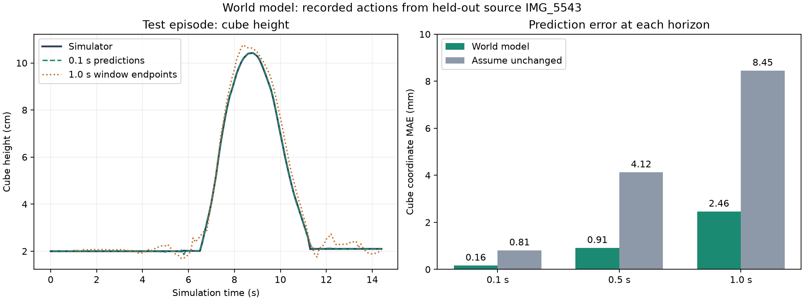

# First world model: prediction baseline

The new state world model predicts robot and cube motion from the current state
and a requested action. It has 8,540 trainable parameters and was trained on CPU.
It is ready for further prediction experiments; robot control still uses BC.

## Data and training

Dataset v2 was generated with the selected 1.0 rad/s closing rate, keeping the
original +/-3.5 N m jaw torque limit. All 65 demonstrations passed the task and
contact-depth checks. The original v1 files remain unchanged.

The source split is preserved: IMG_5539/5540/5541 are training, IMG_5542 is
validation, IMG_5543 is test. There are 63 training episodes with 9,529 transitions,
149 validation transitions and 144 test transitions. The 63 training episodes
are simulated variants derived from three phone recordings.

Training ran for 150 epochs with seed 7. Epoch 108 was selected using validation
normalized physical-change MSE. All normalization statistics use training data.
The test source was opened for evaluation after checkpoint selection was finished.

## What the network predicts

The input contains 35 current-state values plus four action values:

- Six robot joint positions and the cube's position and orientation (13 values).
- Robot and cube velocities (12 values).
- Hand position (3 values).
- Commanded hand target, applied gripper command, bin goal (7 values).
- Action: three target increments and a requested native gripper target.

The network predicts changes in the first 28 physical values. Commands update
using the known controller rules, including gradual closing. The cube quaternion
is normalized after prediction. Joint positions and hand position are predicted
separately, so exact kinematic consistency is not guaranteed.

The model receives no video images, trajectory time, phase labels or future
measured states. Phase labels are used only to summarize errors afterward.

## Prediction results

Cube MAE is the mean absolute error across x, y and z coordinates, in millimetres.
Persistence means predicting that the physical state remains unchanged.

| Horizon | Validation model | Validation persistence | Test model | Test persistence |
| --- | --- | --- | --- | --- |
| 0.1 s, one step | 0.144 | 0.873 | 0.160 | 0.806 |
| 0.5 s, five steps | 0.856 | 4.473 | 0.908 | 4.125 |
| 1.0 s, ten steps | 2.439 | 9.194 | 2.456 | 8.449 |

The test one-step hand-position MAE is 0.155 mm. Shuffling the supplied actions
raises test one-step cube MAE to 0.906 mm, compared with 0.160 mm using the correct
actions. This diagnostic is evidence that predictions depend on action information;
it is not validation of arbitrary alternative actions.

Grasp and release are harder than stationary phases: test one-step cube MAE is
0.351 mm during grasp and 0.484 mm during release. Release has only two examples
in this episode, so that phase estimate has very limited support.



The one-step curve starts from the measured state at each step. The one-second
curve plots endpoints of overlapping ten-step windows, each initialized from a
measured state. Within each window, predicted states are fed back into the model;
only the recorded action sequence is supplied. It is not a single uninterrupted
prediction of the entire episode.

## Reproduce

With the homework Python environment active, run from the project root:

```bash
python scripts/generate_dataset.py --version v2 --gripper-close-rate 1.0
python scripts/train_world_model.py --epochs 150
python scripts/evaluate_world_model.py --split validation
python scripts/evaluate_world_model.py --split test
```

Existing output folders and dataset reports are protected. For repeated training,
choose a new checkpoint folder with `--out`; evaluation accepts `--checkpoint`
and `--out`. Training accepts `--data` for a different versioned dataset.

The checkpoint and training provenance are in `checkpoints/world_model_v1/`.
Prediction arrays and metrics are in `results/world_model_v1_validation/` and
`results/world_model_v1_test/`. Dataset provenance is in `results/dataset_v2.json`.

## Limits and next experiment

There is one validation source and one test source; overlapping windows are not
independent demonstrations. These results cover recorded teacher actions in the
same scene. The model does not predict contact forces, and sustained gripper
forces remain a simulation limitation.

The first alternative-action experiment is now complete; see
[world_model_action_probes.md](world_model_action_probes.md). The model struggles
to predict the effect of changed commands, especially gripper changes. We have
not enabled model-based control. Next, add action variations from training
families, train a separate checkpoint, and repeat prediction checks before
trying short-horizon action selection around BC. A fresh final evaluation
remains necessary.
