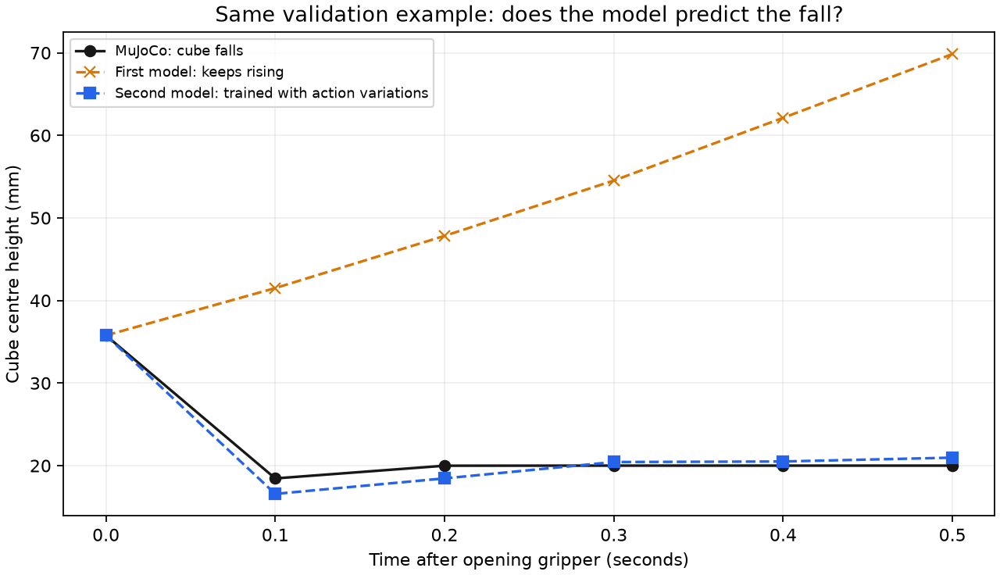

# World model v2: learning from action variations

These notes preserve the earlier experiment. The subsequent online gripper-control
experiment, both controller revisions and all outcomes are documented in
[world_model_control.md](world_model_control.md).

Adding simulated action variations substantially improved prediction of gripper
changes on the validation source. Ordinary-motion prediction became slightly
less accurate. The new model is a candidate for further control experiments;
we have not changed the BC controller or measured a new task-success rate.

## What changed

`collect_action_variations.py` replays the 63 training demonstrations from dataset
v2, all descended from IMG_5539, IMG_5540 and IMG_5541. At six phase-based moments
it copies the entire simulator state and runs ten five-command branches:

- The original command sequence.
- A first-command target shift of +2 or -2 mm along each axis.
- A flipped gripper request for one, three or five commands.

The original target increments resume after the first movement change, so the
target offset persists. Gripper requests resume after the specified duration.
Closing still uses 1 rad/s and the original +/-3.5 N m actuator limit. All finite
branches are retained, including dropped objects; this is dynamics data, not a
new set of successful imitation demonstrations.

There are 3,780 branches containing 18,900 new transitions. Combined with 9,529
ordinary training transitions, training uses 28,429 transitions. These simulations
still come from only three real training recordings. Validation and test sources
contribute no extra training data. Existing demonstration datasets remain intact.

## Training and selection

The architecture remains a 39-input, two-hidden-layer (64 units each), 28-output
network with 8,540 parameters. It was trained from scratch using seed 7, AdamW
with learning rate 0.001, batches of 256, and 150 epochs. Normalization was fitted
to the combined training data. Epoch 118 was selected by normalized physical-delta
MSE on the original validation recording. Alternative-action validation results
were inspected after checkpoint selection; test data was not evaluated for v2.

This is one run, not a seed sweep. More data at the same epoch count also means
more optimizer updates. Normalization scales changed with the training set, so
normalized training/validation losses should not be compared directly between
v1 and v2. Physical-unit prediction errors are compared below.

## Validation comparison

All table entries are cube coordinate mean absolute errors in millimetres.
Lower is better. The same actual simulator branches and actions were verified
to be identical between model evaluations.

| Check | First model | Second model |
| --- | ---: | ---: |
| Ordinary recorded actions, 0.1 s | 0.144 | 0.172 |
| Ordinary recorded actions, 0.5 s | 0.856 | 1.153 |
| Ordinary recorded actions, 1.0 s | 2.439 | 3.066 |
| Six selected anchors, nominal actions, 0.5 s | 1.441 | 1.123 |
| Selected anchors, small movement changes, 0.5 s | 1.683 | 1.148 |
| Selected anchors, one-command gripper flip, 0.5 s | 10.323 | 1.147 |

Ordinary-motion evaluation uses all valid starting windows; the action probes
use only six contact/transport moments. These are different sets of states,
which explains why their nominal averages differ. The ordinary-motion regression
must be reported even though the selected-anchor average improved.

The gripper-flip error decreased by approximately 89%. In the same early-transport
example used to diagnose v1, v2 now predicts the cube falling after the gripper
opens. This illustrates one case, not a general success rate.



## Does it predict the effect of changing an action?

Compare the difference between each changed-action outcome and its nominal
outcome. The baseline assumes the action change has no physical effect.

| Change, 0.5 s | First-model effect error | Second-model effect error | Ignore-change baseline |
| --- | ---: | ---: | ---: |
| Position | 0.933 mm | 0.669 mm | 0.474 mm |
| Gripper | 10.021 mm | 1.674 mm | 9.258 mm |

The gripper result now beats the baseline clearly. The position-effect result
still does not at 0.5 seconds. At 0.1 seconds, the new position-effect error is
0.224 mm versus the baseline's 0.433 mm. Longer prediction horizons remain harder.

The improved response to unseen validation-source gripper changes supports the
data-coverage explanation, but does not isolate it from extra optimizer updates
or changed scaling. Training-family probe scores overlap the new training data
and are fitting diagnostics, not generalization evidence.

## Reproduce

From the project root, with the existing homework environment active and
ROBOT_LEARNING_HW3 set:

```bash
python scripts/collect_action_variations.py
python scripts/train_world_model.py --extra-transitions data/action_variations_v1 --out checkpoints/world_model_v2 --epochs 150
python scripts/evaluate_world_model.py --split validation --checkpoint checkpoints/world_model_v2/world_model.pt --out results/world_model_v2_validation
python scripts/probe_world_model.py --checkpoint checkpoints/world_model_v2/world_model.pt --out results/world_model_v2_action_probes
```

Existing output folders are protected. To repeat, choose new output folders and
update dependent paths. Without `--extra-transitions`, training follows the
original data path. Original v1 training code is archived under
`results/world_model_v1_training_sources/`.

Data and source hashes are recorded in `data/action_variations_v1/manifest.json`.
The training summary includes that manifest, transition counts and selection
method. Model comparisons and result hashes are in
`results/world_model_v2_comparison.json`.

## Next experiment and remaining limits

A reasonable next experiment is a restricted, short-horizon comparison of BC
alone with BC plus model-based evaluation of gripper choices. Avoid assuming
that unrestricted position planning is ready. Fix the candidate choices and
scoring rule before measuring outcomes, and report both failures and successes.
A fresh final evaluation is still needed after development decisions are fixed.

One validation recording and correlated windows are weak evidence for broad
generalization. Additional personally recorded demonstrations would help, but
they do not directly supply robot gripper commands or forces. Assign whole new
recordings to splits before using them and keep their descendants together.

Contact-force realism, camera calibration, dependence on the homework checkout,
and prediction outside this scene remain limitations. The model predicts states,
not forces; no physical robot safety or improved task success is established.
